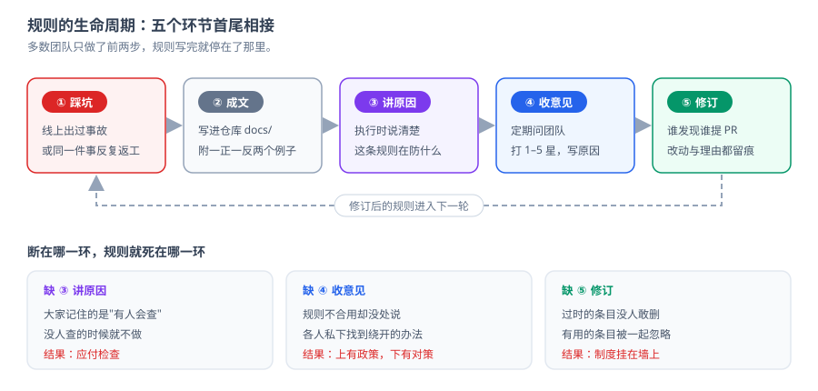

## 前言

ExpenseFlow 团队的 wiki 里有一份《开发规范》，一共 47 条，最后一次修改是 14 个月前。

新人入职第一天被要求通读一遍，之后再没人打开过。其中第 12 条写着"所有接口必须提供 XML 和 JSON 两种返回格式"，而项目里早就没有一个 XML 接口了。没人删它，因为没人知道当初为什么要写它，也没人确定删了会不会有问题。

这是规则最常见的结局：**不是被推翻，而是被绕开。**大家嘴上都认，手上各做各的，所谓"上有政策，下有对策"。

规则本身没有错。把重复出现的事情写下来，省掉每次重新商量的成本，是团队协作里投入产出比最高的一件事。出问题的是规则写完之后的那一段：没人讲它为什么存在，没人问它还合不合用，也没人敢改它。

## 一、规则管常规，例外靠判断

一条好规则的作用可以概括成一句话：**把常规的事系统化，把例外的事留给人。**

| 规则带来的 | 规则的代价 |
|---|---|
| 决策更快，不必每次从头讨论 | 写下来、维护它要花时间 |
| 做法一致，换个人接手也看得懂 | 技术类规则过时得很快 |
| 新人上手有据可依 | 规则本身可能写错 |
| | 有人会在不适用的场合硬套 |

右边最后一条最容易被忽视。没有哪条规则能覆盖所有情况。

ExpenseFlow 的规范里有一条"PR 必须两人批准才能合并"。某个月末凌晨两点，审批接口出了故障，在线的只有小陈和老周两个人，小陈写修复，老周一个人批。按规则，这个 PR 合不进去。

硬套规则的做法是把第三个人从床上叫起来。合理的做法是：老周一个人批准并合并，在 PR 里写明"线上故障紧急修复，单人批准，次日补审"，第二天让小赵补看一遍。

例外可以有，但要满足两点：**当事人清楚这条规则在防什么**（防的是没人把关的代码进主干），**例外留了痕迹**（事后有人补上了把关）。两点都满足，规则的目的就没有被破坏。

反过来，如果同一条规则每个月都要破例三四次，那不是例外，是规则该改了。

## 二、发现规则有问题，当场改

规则失效的第二个原因，是大家默认"改规则是别人的事"。

有一幅流传很广的漫画：船在漏水，一个人从船的这一侧舀水，倒进船的另一侧。照着一条明知没用的规则干活，就是这个样子。

看到规则有问题时，有三个选择，按优先顺序排列：

1. **马上改。**规则有错别字、链接失效、例子过时，直接改掉。这是首选。
2. **改动太大，就给自己记一条待办。**写清楚哪条规则、哪里不对、打算怎么改，放进任务系统，而不是放在脑子里。
3. **请别人改，用"把 X 改成 Y"的格式。**不要说"第 12 条好像有点问题"，要说"建议把第 12 条'所有接口必须提供 XML 和 JSON 两种格式'改成'接口统一返回 JSON'，因为项目里已经没有 XML 调用方"。

第三条的格式很关键。"好像有问题"把思考的成本转给了对方，"把 X 改成 Y"让对方只需要回答同意或不同意。

要让"当场改"成立，规则得放在一个人人能改、改动有记录的地方。ExpenseFlow 后来把《开发规范》从 wiki 搬进了代码仓库的 `docs/` 目录，改规则和改代码走同一套流程：提 PR，说明原因，有人评审。谁在什么时候因为什么改了哪条，一目了然。

## 三、执行规则时，把原因讲出来

规则大多来自一次教训。写规则的人记得那次教训，后来的人只看到一条命令。

小赵提了一个 PR，没有附界面截图。老周有两种回法：

> ❌ "PR 没有截图，不符合规范，补一下。"

> ✅ "这个 PR 改了报销单列表的布局，麻烦补一张改动前后的截图。原因是评审的人不一定会把分支拉下来跑，上次列表的金额列被挤掉，就是因为没人看到实际效果，一直到测试环境才发现。截图能让这类问题在评审阶段就被看见。"

第一种说法能让小赵这次补上截图，但他记住的是"老周会查截图"。老周不看的时候，截图就没了。

第二种说法多花了三十秒，小赵记住的是"截图是为了让评审的人看到效果"。下次他改一个纯后端接口，会自己判断不需要截图；改了界面，会自己补上。**讲了原因，对方才有能力判断例外。**

用规则压人的后果是表面服从。"规定就是这样"这句话，在中文语境里尤其容易被理解成"我不想跟你解释"。

如果一条规则你自己也讲不出原因，回到第二节：它大概该改了，或者该删了。

## 四、纠正别人的分寸

团队里每个人都可以指出别人工作中不符合规范的地方，前提是分清轻重。同样的语气去说一个错别字和一个安全漏洞，对方很快就会对所有提醒免疫。

| 级别 | 是什么 | 例子 | 怎么处理 |
|---|---|---|---|
| 小提示 | 团队约定俗成的写法 | 提交信息的前缀格式、分支命名 | 顺口提一句，或者直接帮忙改掉 |
| 建议 | 有明确理由的更好做法 | 接口错误信息应该告诉调用方怎么修正 | 说明理由，附上规则链接 |
| 必须改 | 会造成误解、事故或安全问题 | 把密钥提交进了仓库；对客户把"估算"写成了"报价" | 立刻处理，当面或电话沟通 |

几条通用的做法：

- **先肯定，再纠正。**"这个 PR 拆得很干净，有一处命名可以和现有的保持一致"，比直接甩一句"命名不规范"容易被接受。
- **小问题顺手改掉，再告诉对方改了什么。**比起让对方来回折腾一趟，这样更快，对方也看到了正确的写法。
- **同一个问题反复出现，逐级加码。**第一次发一条消息附上规则链接，第二次当面聊两句，第三次正式谈一次。直接从第一次跳到正式谈话，会让人觉得被针对。
- **等对方情绪平稳再说。**对方刚被线上故障折腾了一晚上，这时候纠正提交信息的格式，说得再对也没用。

被纠正的一方也有该做的事：说声谢谢，改掉。对方肯花时间指出来，比看见了不吭声要可贵。

## 五、定期问一问：这条规则还好用吗

即便是看上去运转良好的规则，也值得定期拿出来问一遍。做法分四步：

1. **写一段说明。**想引入或调整的规则是什么，解决什么问题，附上正反两个例子。
2. **发问卷，定截止日期。**问题要同时允许正面和负面的意见，再加一道 1 到 5 星的打分题。星级的平均值能直观反映团队的态度，比一堆文字意见更容易比较。
3. **把所有意见过一遍。**不只是挑自己认同的看。
4. **公布结果。**采纳了哪些，没采纳哪些，为什么。

第四步决定了下一次还有没有人填问卷。意见交上去没有回音，大家就会得出"填了也没用"的结论。

ExpenseFlow 用这个办法复查过"PR 必须两人批准"这条规则。打分只有 2.8 星，意见集中在"小改动也要等两个人，一等就是半天"。最后规则改成了：改动 50 行以内且不涉及审批金额逻辑的 PR，一人批准即可。破例的次数随之降到了接近零。

## 小结

一条规则能不能活下来，可以用四个问题检查：

- 能不能用一两句话讲清楚它在防什么？
- 团队里任何人发现它有问题，能不能在十分钟内提出修改？
- 上一次有人破例是什么时候，破例留痕了吗？
- 上一次问大家"这条还好用吗"是什么时候？

四个问题都答得上来的规则，才是给人用的。
