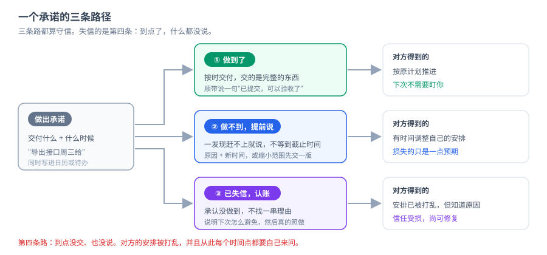

## 前言

周一站会上，小陈说："报销单导出接口周三给。"

周三过去了，没有动静。周四上午，产品负责人岚姐在群里问了一句，小陈回："哦，还差一点，今天下午。"周四下午也没给。周五中午，接口提交了。

晚了两天，事情不大，也没有造成什么后果。但从那以后，小陈说的每一个时间点，岚姐都会在自己的本子上另记一笔，到时间主动去问。小陈并没有偷懒，那两天他被一个线上问题缠住了。只是岚姐不知道。

**信任不是被一次大的失信毁掉的，而是被很多次"差一点"磨掉的。**而一旦别人需要盯着你，你的每一个承诺就多了一份别人的管理成本。

"凡事有交代，件件有着落，事事有回音"这句话人人都听过。它常被当成一种品质，仿佛有的人天生靠谱。其实它是一套可以拆解、可以练习的做法。

## 一、承诺的三段式

说到做到，拆开是三件事：

1. **做到了**：在答应的时间，交付答应的东西。
2. **做不到，提前说**：一发现赶不上，立刻告诉对方原因，同时给出新的时间，或者一个缩小了范围的交付物。
3. **已经失信，认账**：承认没做到，说明下次怎么避免。

多数人的问题出在第二段。周二下午小陈就知道周三交不了，但他想的是"今晚加个班也许能赶上"。于是他选择了不说。

这里有一个不对称：**提前说，对方损失的是一点预期；到点才说，对方损失的是他基于你的承诺所做的全部安排。**岚姐已经跟财务部约了周四演示导出功能，她周二知道延期，可以改约；周四上午才知道，只能当场道歉。

提前说的句式很简单，三个要素：

> "导出接口周三给不了。原因是昨天开始在查审批超时的线上问题，占了一天半。两个选择：周五中午给完整版；或者周三先给不带筛选条件的版本，筛选周五补上。你看哪个合适？"

原因、新时间、可选方案。不需要长篇解释，也不需要道歉三遍。

## 二、同一天的两种过法

承诺不只是"周三交接口"这样的大事，一天里有十几个小承诺。把同一天按两种方式过一遍：

| 时间 | 不靠谱的过法 | 靠谱的过法 |
|---|---|---|
| 10:00 需求评审 | 迟到 10 分钟，进来时大家重讲了一遍背景 | 日历提前 5 分钟提醒，准时进会 |
| 10:50 会议快结束 | 议题没讲完，拖了 30 分钟，后面有会的人中途离开 | 还剩 10 分钟时问一句"谁有硬性的结束时间"，先处理这些人关心的议题 |
| 11:30 会后 | 说"纪要我回头发"，第二天下午才发 | 当场设一个手机提醒，一小时内发出 |
| 14:00 收到同事消息 | 看了一眼，想着忙完再回，两小时后忘了 | 能答就马上答；不能答就回一句"在处理线上问题，四点前回你" |

右边一列没有一件事需要特殊的能力。区别只在于：**每个承诺出口的同时，都落在了一个会主动提醒自己的地方。**

## 三、别用脑子记

人的记忆并不可靠，尤其是在一天被打断十几次的情况下。"我记着呢"是失信最常见的前奏。

答应的那一刻，花十秒钟把它从脑子里搬出去：

| 场景 | 做法 |
|---|---|
| 口头答应的小事（"下午把链接发你"） | 手机提醒，锁屏状态下用语音就能设 |
| 有具体时间、涉及他人的事 | 日历日程，带提前提醒 |
| 发出消息后等对方回复 | 给这条消息设"稍后提醒"，或者用定时发送给自己留一条跟进消息 |
| 需要以后某个时间再处理的邮件 | 邮件客户端的稍后处理或定时提醒功能 |
| 一件完整的任务 | 建一个工作项；没有任务系统，就给自己发一封邮件并抄送给提需求的人 |

企业微信、钉钉、飞书都有消息提醒和待办功能，用哪个不重要，重要的是只用一两个，并且每天会看。贴在显示器边上的便利贴不算，它不会在周三上午主动提醒你。

最后一行里"抄送给提需求的人"有两层作用：对方确认你理解的任务和他说的是同一件事；这封邮件成了双方都能查到的记录。

对于开发团队，这件事还有两个现成的工具：

- **完成的定义**：所有功能通用的标准，比如"已部署到测试环境、已通过测试"。它回答的是"做到什么程度算做完"。
- **验收标准**：某一个功能自己的细节，比如"导出文件包含审批人和审批时间两列"。它回答的是"做的是不是对方要的"。

很多"我以为做完了"的争执，根源是这两样东西从来没写下来。

## 四、估时留余量

失信的另一个来源是答应得太满。

"五分钟就好"几乎从来不是五分钟。经验上的折算：说五分钟的事，按十五分钟算；预计半小时的事，按一到两小时安排。这不是磨洋工，而是把查资料、被打断、环境出问题这些每次都会发生的事算了进去。可以称之为"健康的悲观"。

答应之前，先看一眼自己的日历和手上的任务。几种更诚实的说法：

- 有把握：**"周三下班前给你。"**
- 没把握：**"我先看一下工作量，今天下午三点前告诉你哪天能给。"**这句话本身也是一个承诺，但它是一个你肯定做得到的承诺。
- 做不了：**"这周排不进去。最早下周二，或者你看看小赵有没有空。"**

在国内的工作环境里，当面说"做不了"确实有压力，很多人会先应下来再说。但应下来又做不到，比当场说排不进去更伤信用。把"不"换成"最早什么时候可以"，通常双方都能接受。

## 五、没有人会提醒你的活

有一类任务特别容易掉在地上：周期性的、不出事就没人想起来的。

- 证书和域名快到期了没有
- 备份还能不能恢复出来
- 依赖库有没有安全更新
- 测试环境的磁盘满了没有

它们的共同点是重要但不紧急，没有人催，直到出事的那天。

处理办法分两类。每天、每周都做的事，靠习惯和流程，不需要额外提醒。**每月一次或更低频率的事，一律放进日历做成循环日程**，因为一个月足够把任何事忘干净。

如果到了时间却做不了，比如没有权限、依赖别人，当天就告诉负责人。周期性任务悄悄跳过一次，往往就意味着之后的每一次都被跳过。

## 六、交出去的事，仍然是你的事

把任务转给别人之后，很多人心里就划掉了这一项。

岚姐让小陈确认导出文件的格式，小陈转头问了财务部的王经理，然后等着。王经理没回。三天后岚姐问起来，小陈说："我问过王经理了，他没回我。"

这句话是事实，但它没有解决任何问题。对岚姐来说，她交给小陈的事没有着落。

**委托不等于完成。**问出去的同时，给自己设一个跟进提醒："周四上午王经理没回的话，打电话。"事情是你答应的，无论中间转了几道手，最后给出交代的人都应该是你。

## 小结

每天能用的四个动作：

- 答应之前，看一眼日历，把估时乘以二。
- 答应的同时，把它写进一个会提醒你的地方。
- 一发现做不到，立刻说，带上原因和新的时间。
- 转给别人的事，给自己留一个跟进的时间点。
