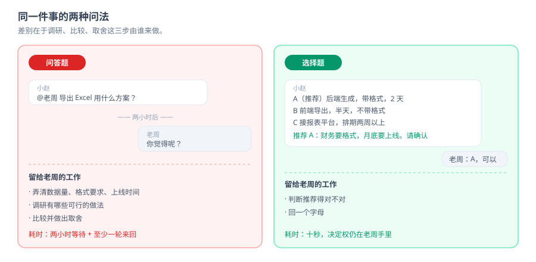

## 前言

小赵在群里发了一条消息：

> "@老周 报销单导出 Excel 用什么方案？"

老周在开会。两个小时后他回了三个字："你觉得呢？"

小赵有点委屈，觉得自己明明是在请示，却被踢了回来。老周也有点无奈，要回答这个问题，他得先弄清楚导出的数据量有多大、要不要带格式、前端能不能做，而这些信息小赵比他清楚。

国内的团队并不缺"请示汇报"的习惯，缺的是请示的质量。**大多数请示是一道问答题：把问题原样交上去，等一个答案下来。**出题的人掌握着最多的上下文，却让掌握最少上下文、时间也最少的人来作答。

## 一、问答题和选择题

同一件事，换一种问法：

> "@老周 报销单导出 Excel，我看了三个方案：
>
> **方案 A（推荐）**：后端用 ClosedXML 生成文件。财务要求的合并单元格和金额格式都能做，单次导出上限先定 5000 行，工作量约 2 天。
>
> **方案 B**：前端用 SheetJS 直接导出当前列表。半天能做完，但只能导出当前页已加载的数据，带不了格式。
>
> **方案 C**：接公司的报表平台。功能最全，但要走接入申请，排期至少两周。
>
> 推荐 A，原因是财务明确要带格式，B 满足不了；C 赶不上月底。没有异议的话我明天开始按 A 做，请确认。"

老周在会议间隙看到这条消息，回一个"A，可以"就结束了。前后十秒钟。



两种问法的差别不在礼貌，而在于谁来做那部分思考。第一种问法里，调研、比较、取舍全留给了老周；第二种问法里，这些小赵已经做完了，老周只需要判断"推荐得对不对"。

**带方案去请示不是越权。**决定权仍然在领导手里，他可以选 B，也可以说三个都不行。你做的只是把决定的成本降到最低。

## 二、选项怎么给

几条让选择题更好答的做法：

- **三个左右为宜。**只有一个选项，对方无从比较；给到五六个，等于又把筛选的工作还了回去。
- **用 A、B、C 标出来，叫"方案"而不是"版本"。**"版本"听起来像前后迭代的关系，"方案"才是并列的选择。标了字母，对方回复时只需要打一个字符。
- **明确写出推荐哪个，以及为什么。**只罗列不推荐，等于把问答题换成了一道没有提示的选择题。
- **每个方案带上代价。**工作量、风险、依赖谁，各用一句话。
- **以一个明确的动作结尾。**"请确认"或者"没有异议的话我明天开始做"。对方看完知道自己需要做什么。

如果是技术方案，把接下来的步骤也列出来。领导批准的不只是一个方向，还有你打算怎么走。

## 三、不是自己的专业，也先出一版

"带方案"最常见的障碍是："这不是我擅长的，我给不出方案。"

ExpenseFlow 的报销单有一个状态字段，需要定状态的名称和对应的颜色。小陈是后端，他的第一反应是等设计师来定：

> ❌ "状态的文案和颜色需要设计出一下，设计不是我的强项。"

设计师这周在忙别的项目，这件事就停在了那里。

另一种做法是给自己限定十五分钟，借助 AI 起草一版：

> ✅ "报销单状态我先拟了一版，请设计帮忙看看：
>
> 草稿（灰）、待审批（蓝）、已通过（绿）、已驳回（红）、已打款（深绿）。
>
> 依据：状态名和企业微信审批的叫法保持一致，用户不用重新学；颜色用的是现有按钮已经在用的那几个，没有引入新色值。
>
> 过程：花了 15 分钟，让 Copilot 列了常见审批系统的状态命名，再对照我们现有的色板挑的。不确定的地方是'已打款'要不要单独一个颜色。"

这一版很可能不完美。但设计师从"凭空设计"变成了"在一版草稿上修改"，后者快得多。

写清楚过程有它的用处：花了多久、参考了什么、哪里没把握。对方据此判断这版草稿可以信到什么程度，从哪里改起。

很多人不愿意先出一版，是怕在别人的专业领域说错话，显得外行。其实恰恰相反，一版标明了"不确定之处"的草稿，展示的是认真；一句"这个不归我管"，才会让人记住。

## 四、被抄送时，主动起草回复

财务部王经理给老周发邮件，问导出功能能不能加上"按部门汇总"，同时抄送了小赵，因为导出是小赵做的。

小赵有两种反应。一种是看一眼，心想"问的是老周"，关掉。另一种是意识到自己被抄送的原因：这件事的细节只有自己清楚，老周多半会转头来问。

第二种反应下，小赵单独给老周发了一条消息（先去掉王经理，内部先对齐）：

> "王经理问的按部门汇总，技术上可以做，在现有导出基础上加一个工作表，约 1 天。建议放到下个迭代，因为这个迭代的导出还没验收。我起草了一段回复，你看看能不能直接用：……"

老周改了两个字，发了出去。

当你是某件事的知情人，又被抄送在一封邮件里，就默认对方会需要你的意见。等人来问再回答，和主动递上一段可以直接用的回复，在领导眼里是两种截然不同的同事。

## 五、让 AI 帮忙改写，但数字自己核对

把一个问题改写成带推荐的请示，现在可以让 AI 代劳一部分：

```text
把下面这个问题改写成给技术负责人的请示：
列出三个可选方案，每个方案写明工作量和主要风险，
标出推荐方案并说明理由，最后以"请确认"结尾。

问题：报销单导出 Excel 用什么方案？
背景：财务要求带合并单元格和金额格式；月底前要上线；
单次导出数据量一般在 2000 行以内。
```

AI 给出的方案结构通常不错，但里面的工作量估算、库的能力边界、数据量上限，都可能是它编的。**署名的是你，推荐是你的推荐。**每一个事实和数字，发出去之前自己核对一遍。

## 六、主动找产品负责人，别等对方来找你

带方案请示解决的是"怎么问"，还有一个问题是"多久问一次"。

每周的需求沟通会被取消了一次、两次，岚姐出差了一周，转眼就是半个月没有对过方向。这期间小赵做的东西，可能已经和岚姐脑子里的样子偏了一截。

几个简单的习惯：

- **最长不超过两周不和产品负责人沟通。**例会取消了，就在走廊里、电话里花五分钟同步一下。
- **有风险时主动约时间。**眼看要延期、需求有歧义，不要等到例会，自己发起一个十五分钟的会。
- **平时攒一个"要问岚姐"的清单。**不紧急的问题随手记下，对方一有空问"谁有事找我"，你手里立刻有东西。

把问题攒成一批再去问，还有一个附带的好处：对方被打断一次，而不是十次。

## 小结

发出请示之前，对照检查：

- 我是在问"怎么办"，还是在问"这样行不行"？
- 有没有给出两到三个方案，并标明推荐哪个？
- 对方只回一个字母，这件事能不能推进？
- 里面的数字和事实，是不是都核对过？
