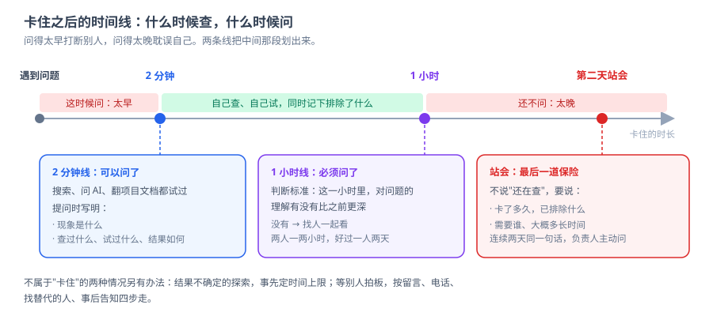

## 前言

周二站会，小陈说："昨天在查审批流的一个并发问题，今天继续。"

周三站会，他说了同样的话。

周四老周坐到他旁边看了二十分钟，指出问题出在 EF Core 的乐观并发标记没有配置。小陈在这个问题上已经耗了两天半。

团队里卡住的方式有两种，方向相反，代价都不小。一种是**问得太早**：遇到问题想都不想就在群里 @ 人，把别人当搜索引擎。另一种是**问得太晚**：一个人闷头死磕，不好意思开口，怕显得自己不行。

国内的开发者里，后一种更常见。"这点事还要问人"的顾虑，加上对"独立解决问题能力"的看重，让很多人宁可多熬两天。

解决办法是给"什么时候该问"定几条明确的线。有了线，开口就不再是面子问题，而是照规矩办事。

## 一、先查两分钟，并且说明查过什么

发消息问人之前，先自己查两分钟：搜一下，问一下 AI，翻一下项目文档。

相当一部分问题在这两分钟里就解决了。没解决的，提问时带上一句你查过什么：

> ❌ "老周，EF Core 并发冲突怎么处理？"

> ✅ "老周，审批接口两个人同时点通过，后一个会覆盖前一个。我查了 EF Core 文档里的并发标记，给 `Expense` 加了 `RowVersion`，但还是没有抛 `DbUpdateConcurrencyException`。配置代码在这里：……是不是还漏了什么？"

第二种问法有三个好处。对方不必从"你试过搜索吗"开始问起；对方可以直接跳过你已经排除的方向；写下这段话的过程中，你自己可能就发现了问题所在。

即时消息的代价是打断。对方正在专注写代码，被打断一次，重新进入状态要十几分钟。花两分钟查一下，是对这十几分钟的基本尊重。

## 二、一小时线：同一个问题卡了一小时，就开口

另一头的线同样明确：**同一个问题卡了超过一小时，没有实质进展，就去问人。**

"实质进展"的意思是，你对问题的理解比一小时前更深了，排除了某些可能，或者缩小了范围。如果一小时后你还在重复尝试差不多的办法，那就是没有进展。

一个值得记住的比较：两个人一起看，一两个小时解决；一个人硬扛，两天。算人时，前者花掉的也远少于后者。**没有人会因为独自解决了一个问题而拿到奖章**，团队要的是问题被解决，不是谁解决的。

每天的站会是提出卡点的固定场合。"我在查并发问题"不算提出卡点；"并发问题我卡了一天，已经排除了事务隔离级别的原因，想找个熟悉 EF Core 的人一起看半小时"才算。

对于带团队的人，站会上连续两天听到同一个人说"继续查同一个问题"，就该主动问一句需不需要帮忙。很多人不会自己开口。

## 三、给探索设一个上限

一小时线管的是"卡住了"。还有一类任务不算卡住，但同样会无声地吞掉时间：结果不确定的探索。

给这类任务设一个时间上限，到点就停下来汇报，由团队决定继续还是放弃。三种情况尤其需要：

- **锦上添花的功能。**做了更好，不做也行。比如给导出加一个进度条。
- **有风险、可能走不通的尝试。**比如"试试能不能把审批查询改成一条 SQL"。
- **难以估计工作量的未知问题。**比如"查一下为什么测试环境偶尔慢"。

任务描述里直接写上限：

> "调研报销单列表能否改用游标分页。**时间上限 4 小时**，到点无论有没有结论，都在群里同步进展。"

时间上限传达的其实是这件事值多少：我们愿意为它花四个小时，不是四天。到点没有结果不算失败，"这条路四小时走不通"本身就是有价值的结论。

## 四、等别人拍板时，别原地等

第三种卡住和技术无关：你需要某个人批准或答复，而这个人联系不上。

小赵周四要上线导出功能，需要老周确认单次导出的行数上限。老周在客户现场，消息没回。小赵可以等，但等到周四，上线就黄了。

分四步处理：

1. **先留言，再打电话。**消息里说清楚："导出行数上限需要你确认，我卡在这一步，现在给你打电话。"打电话不是不礼貌，被阻塞才是成本。
2. **没接通，留言说明下一步。**"刚打了电话没接通，我四点再打一次。"然后设一个四点的提醒。
3. **仍然联系不上，告知将找其他人。**"还是没联系上你，上线时间比较紧，我去找岚姐确认。"
4. **拿到答复后，回头告知原来的人。**"行数上限岚姐确认按 5000 行，记录在这封邮件里，已抄送你。"

第四步不能省。绕过一个人做了决定，却不让他知道，是非常伤信任的事。

这套办法有它的适用范围：

- **它是例外，不是常规。**先多试几次联系本人，确实影响进度了再找别人。
- **找谁有顺序。**本人，然后是他的上级或同级的负责人，而不是随便找一个好说话的。
- **对方最在意的事情不要绕。**涉及预算、人员、对外承诺这类事，宁可等。

## 五、发起审批时，带上截止时间

站在发起方的角度，有一个办法可以从源头减少"等审批"：**请求里写明期限，以及过期后的默认做法。**

> ❌ "导出功能的方案麻烦看一下。"（然后每隔两天追问一次）

> ✅ "导出功能的方案在这里，计划 10 月 23 日上线。请在 10 月 16 日周五下班前反馈。到时没有异议的话，我按方案 A 进入开发。"

几个细节：

- **期限要留足。**对方如果在意这件事，应该有充分的时间认真看。上线前两周发出，给一周时间，是合理的。
- **中途提醒两次。**期限过半时一次，最后一天一次。这样对方如果需要延期，有机会提出来。
- **延期可以，无限期不行。**"再给我三天"完全合理；"我没批之前不许动"则会让整件事回到无限等待。

这种做法在层级观念较重的团队里，一开始可能让人觉得有些"逼宫"。实际用下来，多数审批者是欢迎的：他们本来就忙，一条写明了期限和默认做法的请求，替他们省掉了"这件事我到底要不要回"的判断。

## 六、两个人做同一件事

最后一个办法是预防性的：尽量让每个项目上至少有两个人。

这里说的不是两个人挤在一台电脑前。那种做法适合集中讨论方案，不适合当作常态。指的是**两个人做同一个项目，各用各的电脑，坐得近，或者保持随时可以通话**。

好处很直接：卡住的时间变短，因为旁边就有人了解上下文；知识不会只装在一个人脑子里；代码里临时凑合的写法变少，因为有人会看。

代价是沟通开销，粗略估计占两成时间。和一个人卡两天半相比，这两成划算得多。

## 小结

| 情况 | 线在哪里 | 该做什么 |
|---|---|---|
| 刚遇到问题 | 2 分钟 | 自己先查；提问时说明查过什么 |
| 持续没有进展 | 1 小时 | 找人一起看；站会上明确提出 |
| 结果不确定的探索 | 事先定好的上限 | 到点停下，同步结论 |
| 等别人拍板 | 影响到进度时 | 留言、电话、找替代的人、事后告知 |
| 发起审批 | 发出请求时 | 写明期限和过期后的默认做法 |
