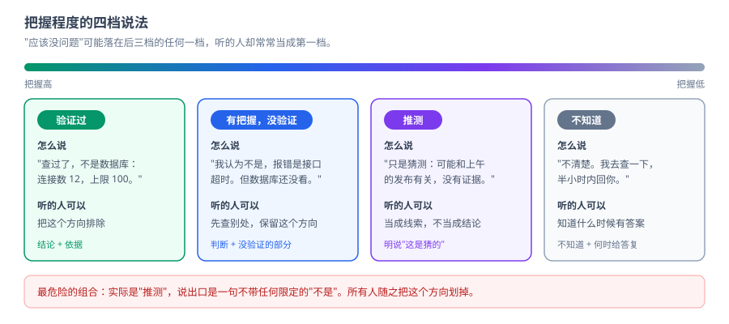

## 前言

岚姐在群里说："报销单列表右边加一个复选框，用来批量审批，要醒目一点。"

小赵回："收到。"

两天后，列表的每一行右侧多了一个红色的复选框。岚姐看了一眼就皱眉了：她要的是表头右上角的一个"全选"复选框，"醒目"指的是位置显眼，不是颜色。

两个人都没说错话，也都没偷懒。问题出在"收到"这两个字上：它只表示消息送达了，不表示理解一致。**岚姐以为小赵听懂了，小赵以为自己听懂了，这两个"以为"之间没有任何东西做校验。**

团队里相当一部分返工不是技术问题，而是话没说准：需求听岔了，猜测被当成了结论，一件三句话能讲清的事在群里打了四十条消息。

## 一、"收到"不等于听懂

1977 年 3 月 27 日，西班牙特内里费岛的机场大雾弥漫。荷兰皇家航空的一架波音 747 在跑道尽头，机组用无线电说了一句"我们现在在起飞"。塔台把这句话理解成"我们在起飞位置待命"，回了一句"好的"，接着说"等待起飞许可，我会呼叫你"。后半句恰好被另一架飞机的通话盖住了，荷航机组只听到了"好的"。

荷航的飞机开始滑跑，撞上了还在跑道上滑行的泛美航空 747。583 人遇难，这是民航史上伤亡最惨重的事故。

事故之后，全球航空通话规则做了修改，其中一条沿用至今：**关键指令必须由接收方完整复述，发出方确认复述无误，才算完成。**一句"好的"或"收到"不再被接受。

软件开发不涉及人命，但机制是一样的。口头或文字传达的指令，在说的人和听的人之间至少会丢失或扭曲一部分。复述是成本最低的校验手段。

回到开头的例子：

> ❌ "收到。"

> ✅ "确认一下：在列表每一行的最右边加一个复选框，勾选后可以批量审批，复选框用红色。对吗？"

岚姐会立刻回："不是每一行，是表头加一个全选；也不用红色，位置显眼就行。"十秒钟，省掉两天。

复述时有意把细节说具体，哪怕猜错了。猜错的复述比模糊的"收到"有用得多，因为它把分歧暴露了出来。

## 二、复述什么

不必把对方的话原样念一遍，复述四个要素：

| 要素 | 示例 |
|---|---|
| 做什么 | 加一个"全选"复选框 |
| 在哪里、什么样 | 表头最右侧，沿用现有复选框样式 |
| 什么时候要 | 这周五随导出功能一起提测 |
| 不做什么 | 这次不做跨页全选，只选当前页 |

第四项最容易漏，也最值钱。很多需求分歧不在"要做什么"，而在"我以为顺带也要做的那些"。把"不做什么"说出口，对方要么确认，要么当场补充。

需求方也可以主动要求复述。岚姐交代完之后加一句"你说一下你的理解"，不是不信任，是在帮双方省时间。这句话由职位高的一方主动说出来，另一方就没有了"多问显得没听懂"的顾虑。

## 三、猜测别说成事实

周五下午，测试环境的报销单列表打不开了。岚姐问："是不是数据库出问题了？"

小陈回："不是。"

小陈并没有去查数据库，他只是觉得不像。但一句斩钉截铁的"不是"让所有人把数据库从排查清单上划掉了。两个小时后才发现，问题正是数据库连接池耗尽。

更准确的回答是：

> "我觉得不像，报错信息看起来是接口超时。但我还没看数据库的状态，要查一下才能确定。你为什么觉得是数据库？"

这句话做了三件事：给出了判断，标明了判断的把握程度，反问了对方的依据。岚姐可能会说"因为运维刚才在群里说连接数告警了"，问题当场就定位了。

中文里有一个使用频率极高的词："应该"。"应该没问题""应该能上线""应该是这个原因"。说的人往往想表达"我推测如此，但没验证"，听的人往往理解成"没问题"。这个词把推测包装成了半个承诺，是最需要拆开来说的一个词。

把"应该没问题"拆成两句：**我验证了什么，我没验证什么。**

> ❌ "导出功能应该没问题了。"

> ✅ "导出功能在测试环境用 200 行和 5000 行的数据各跑了一遍，都正常。还没试的是带特殊字符的部门名称，以及多人同时导出。"

承认"不确定"在很多人看来是示弱。但从听的人的角度，一个会说"这部分我没验证"的同事，他说"验证过了"的时候才真正可信。坦诚地标出把握程度，是建立信任最快的办法之一。可以从小事开始练："这个我不确定，我查一下再回你。"

## 四、换一个频道

话说不准，有时是因为用错了渠道。

文字消息适合传递简单、明确的信息。一旦涉及来回澄清、多方权衡、情绪，文字的效率就急剧下降：打字慢，没有语气，每一轮来回之间还隔着对方被别的事打断的时间。

几条实用的线：

- **同一个问题文字来回超过三轮还没说清，就打电话。**发一句"方便通个话吗"，五分钟通话通常抵得上半小时打字。
- **通话时把关键结论同步打在聊天框里。**"单次导出上限 5000 行；超过提示分批导出。"对方看到文字可以当场纠正，这其实也是一种复述。
- **通话结束后留一条文字记录。**谁、决定了什么、谁在什么时间之前做什么。没有记录的口头决定，一周后会有两个版本。

对方时间凑不上的时候，比如出差、跨时区、整天在开会，可以录一段屏发过去：一边操作一边讲，三分钟能讲清楚的事，写成文字可能要半小时，对方还可以反复看。飞书、钉钉、腾讯会议都自带录屏。

这里要提醒一句国内特有的情况：**录屏和语音是长文字的替代品，不是短消息的替代品。**连着发五条 60 秒的语音，说的却是一句话就能打完的事，对方既不能扫读，也不能搜索，只能一条条听完。判断标准是换位想一下：对方是听一遍更省事，还是看一眼更省事。录屏发出去时，配一两行文字说明要点和需要对方做什么。

## 小结

- 收到任务，用自己的话复述：做什么、什么样、何时要、不做什么。
- 交代任务，请对方说一遍他的理解。
- 回答问题，说明把握程度：验证过、有把握但没验证、推测、不知道。
- 把"应该没问题"拆成"验证了什么"和"没验证什么"。
- 文字三轮说不清，就通话；通话的结论，落回文字。
