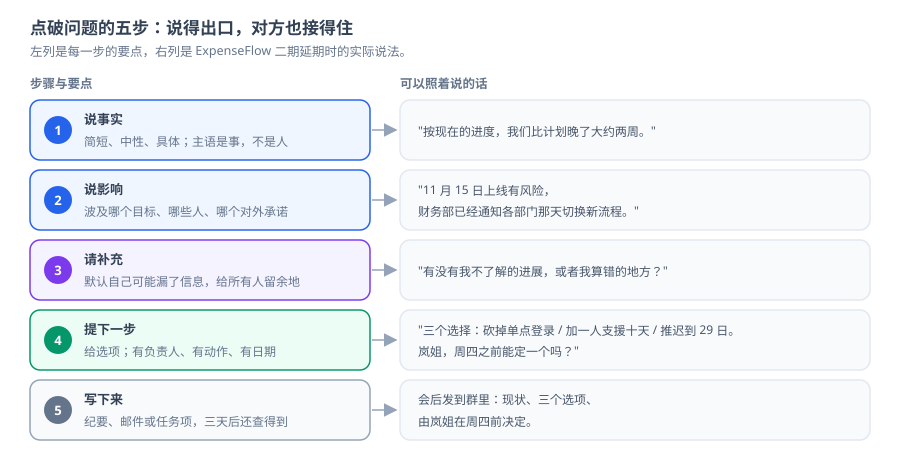

## 前言

ExpenseFlow 的二期计划 11 月 15 日上线。10 月中旬，团队里每个人心里都清楚这个日期保不住了：对接财务系统的接口文档晚到了两周，至今还有三个字段没确定。

周会上，岚姐问进度。小陈说"在推进"，小赵说"问题不大"，老周说"大家辛苦一下"。会议在一片"加油"声中结束。

没有人说出那句话：**"我们赶不上 15 号了。"**

英语里把这种情况叫作"房间里的大象"：一头大象站在屋子中间，所有人都看得见，所有人都绕着走。

这种沉默在国内的团队里有很深的土壤。"报喜不报忧"是对上的本能；"看破不说破"被当成成熟；当众指出问题，怕让负责的同事下不来台。每一种顾虑单独看都有道理，合在一起的结果是：问题拖到 11 月 10 日才摆上桌面，那时候已经没有任何调整的余地。

## 一、点破大象的五个步骤

说出一个问题，并不需要先想好解决办法。只需要把话说得让人接得住。

**第一步，说出看到的事实。**简短、中性、具体，不加评价。

> ❌ "这个项目管理得太乱了。"
>
> ✅ "按现在的进度，我们比计划晚了大约两周。"

**第二步，说出影响。**这件事会波及什么：目标、别人的工作、对外的承诺。

> "财务系统的接口文档晚到了两周，11 月 15 日上线有风险。财务部已经通知各部门那天切换新流程。"

**第三步，请别人补充。**默认自己可能漏了信息。

> "这是我看到的情况。有没有我不了解的进展，或者我算错的地方？"

这一步是给所有人留余地，也包括自己。也许老周已经和财务部谈好了简化方案，只是还没来得及同步。

**第四步，提出下一步。**有负责人，有动作，有日期。

> "我想到三个选择：一是首期不做单点登录，按期上线；二是加一个人支援十天；三是上线推迟到 11 月 29 日。岚姐，这周四之前能定一个吗？"

**第五步，写下来。**会议纪要、邮件、任务项都可以。口头达成的共识，三天后会各有各的记忆。

五步说完，不到两分钟。

## 二、为什么说不出口，以及怎么说才不伤和气

知道步骤不等于开得了口。几种常见的顾虑，各有对应的说法。

**"说出来等于指责负责的人。"**

把句子的主语从人换成事。"小陈的接口延期了"是在说人；"接口对接比计划晚了两周"是在说事。第一步强调"中性、具体"，目的就在这里：一个不带评价的事实，很难被听成攻击。

**"我没有解决办法，说了也白说。"**

发现问题和解决问题是两件事。你看到了船在漏水，不需要先成为修船的人才有资格喊一声。大多数情况下，把问题摆出来，办法是大家一起想出来的。

**"领导肯定知道，轮不到我说。"**

领导很可能不知道，或者知道得没有你具体。每个人都以为别人会说，结果就是没人说。退一步，即便领导知道，由一线的人确认一次，也让他多了一个判断依据。

**"当众说，对方下不来台。"**

这个顾虑是合理的，办法是分场合。涉及具体某个人的问题，先私下跟他说："周会上我想提一下进度的风险，先跟你通个气，你看怎么说合适。"对方有了准备，甚至可能自己主动提出来。给人留面子和把问题说出来，并不冲突。

**"说了，会不会被当成唱反调、不积极？"**

带上选项，这种印象会小很多。只说"赶不上了"像是泼冷水；说"赶不上了，有三个办法"则是在推动事情。

对于团队负责人，有一件事比任何说话技巧都重要：**第一个说出坏消息的人，得到的是感谢还是脸色。**只要有一次有人因为说了实话而被冷落，之后很长一段时间，周会上都只会剩下"问题不大"。

## 三、应对阴阳怪气

话不直说的另一种形态是阴阳怪气。

小陈延期两次之后，在群里催小赵提供接口字段。小赵回了一句：

> "哟，现在知道着急排期了？"

这句话表面是玩笑，底下有情绪。小陈常见的两种反应，一是装没听见，情绪继续攒着；二是怼回去：

> ❌ "你这话什么意思？阴阳怪气的。"

这样一来，话题从排期变成了态度，两个人都收不了场。给对方的话贴上"阴阳怪气"的标签，只会让对方进入防御状态。

更有效的做法分三步：

1. **点出话里有话，但不贴标签。**"听起来你对排期这事有些想法。"
2. **确认自己有没有理解错。**"我是不是该把这句话当回事？"
3. **直接问感受。**"前两次延期，是不是给你那边添了麻烦？"

连起来就是：

> ✅ "听起来排期这事你有些想法。是不是前两次延期让你那边很被动？"

多数时候，对方会顺着这个台阶说出真正的问题："你上次延期，我周末加了一天班去赶联调。"事情到这里才有了解决的可能。小陈可以道歉，可以商量以后延期提前多久通知。

阴阳怪气通常意味着对方有不满，又觉得直说不合适或者说了没用。你把直说的门打开，对方才有路可走。

## 四、觉得不公平的时候

还有一类话更难出口：觉得自己被亏待了。

年底，新项目的技术负责人给了小赵，小陈觉得自己资历更深。季度评优评了别的组，自己组明明加班更多。这类事情很少有人当面提，多半变成私下的抱怨和消极的工作状态。

三个位置上的人，各有该做的事。

**做决定的人**：让决定有据可依，并且把依据说出来。"选小赵是因为新项目以前端为主"，这句话说与不说，小陈的感受截然不同。预料到有人会觉得不公平时，在公布之前先单独沟通。

**得到的人**：低调。炫耀会把别人的失落变成怨气。

**失落的人**：

- **先问，再下结论。**"我想了解一下这次是怎么考虑的，也想知道我差在哪里。"问的是标准，不是讨说法。
- **尽早说，得体地说。**闷在心里的时间越长，说出来的时候越难平静。
- **向对方道贺。**有一句话说得好：朋友先一步梦想成真的时候，也要为他鼓掌。

除了沟通，还有心态上的一个公式值得一提：

**幸福感 = 现实 − 期望**

落差来自两头。改善现实是一条路：争取机会、提升能力、把想法说出来，所谓会哭的孩子有奶吃。调整期望是另一条路：

- **跟自己的过去比，不跟别人比。**今年比去年多掌握了什么，比"他凭什么"有用得多。
- **得到一样，往往要放弃另一样。**技术负责人的头衔，附带的是更多的会议和更少的写代码时间。
- **承认运气的成分。**项目恰好对口、时机恰好合适，很多结果不完全是能力的排序。
- **先弄清对方的考虑。**很多"不公平"在了解了完整信息之后，变成了"原来如此"。

这个公式不是劝人认命。该说的话仍然要说，只是在说之前，先分清哪部分是事实上的不合理，哪部分是自己预期过高。

## 小结

- 看到问题，按五步说：事实、影响、请补充、下一步、写下来。
- 涉及具体的人，先私下通气，再在会上提。
- 听到阴阳怪气，不贴标签，直接问对方的感受。
- 觉得不公平，先问标准，尽早说，对事不对人。
- 负责人要保护第一个说实话的人。
