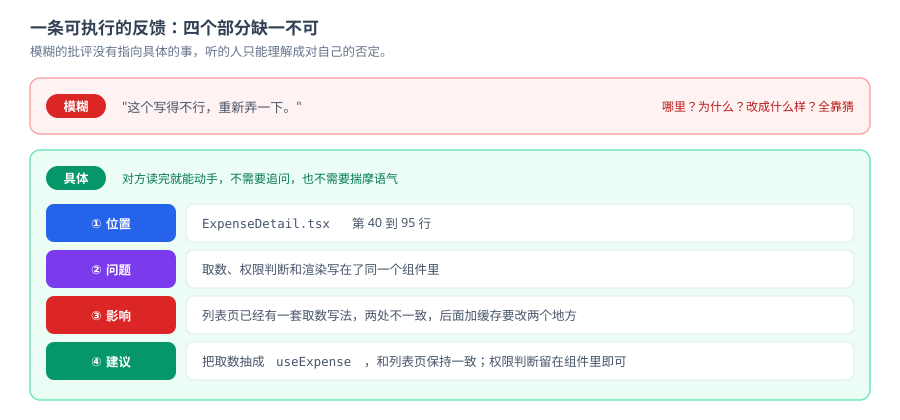

## 前言

小赵提交了报销单详情页的 PR。老周的评审意见只有一行：

> "这个写得不行，重新弄一下。"

小赵盯着这行字看了五分钟。哪里不行？是组件拆分、命名、还是交互？"重新弄"是全部推倒，还是改某一处？他不好意思追问，凭猜测改了一版。老周看完回复："还是不对。"

来回三轮，两个人都窝了一肚子火。老周觉得小赵悟性差，小赵觉得老周故意刁难。

"对事不对人"这句话人人会说，真正的难处在于：**一句模糊的批评，无论说的人本意如何，听起来都是对人的。**因为它没有指向任何一件具体的事，听的人只能把它理解成对自己整体的否定。

提意见的分寸，大半落在"具体"两个字上。

## 一、具体：指出问题，并且给出办法

一条能用的反馈包含四样东西：在哪里、什么问题、有什么影响、建议怎么改。

几组对照：

| 模糊的说法 | 具体的说法 |
|---|---|
| "这个写得不行，重新弄一下。" | "`ExpenseDetail.tsx` 第 40 到 95 行把取数、权限判断和渲染写在了一起。建议把取数抽成 `useExpense`，和列表页的写法保持一致，后面加缓存只需要改一处。" |
| "没做完，再看看。" | "没做完，需求里的第二条漏了：驳回时必须填写原因。" |
| "我们的审批流程太慢了，你们想想办法。" | "二级审批的平均等待时间是 3 天，主要卡在审批人出差时没人代批。建议加一个'委托他人审批'的功能，我先出个方案，周四讨论。" |

第二组只多了半句话，但对方立刻知道去哪里补。第三组的区别更大：左边是把一个情绪扔给别人，右边指出了具体的缺口，并且自己往前走了一步。

**给不出改法的时候怎么办？**有时你只是觉得不对，说不出哪里不对。这时不要硬写一条模糊的意见，直接找对方或者更有经验的人聊十分钟："这个交互我用着别扭，但说不上原因，我们一起看看？"把"我也不确定"说出来，比装作有明确意见要好。

## 二、给出位置

反馈越容易定位，对方处理得越快。

- **代码**：文件名加行号，或者直接在那一行上评论。
- **文档**：引用原句，写明改成什么。"把第三段的'用户'改成'报销人'，和界面上的叫法一致。"
- **界面**：截图，在图上圈出来。
- **录屏和视频**：给时间点。"1:20 到 1:45，点击提交后没有任何提示，我以为没点上。"

"界面有点怪"和"截图里圈出来的这个按钮，和左边的输入框没有对齐"，处理成本相差十倍。

## 三、顺手做了，再告诉对方

纠正别人最得体的方式，往往不是指出错误，而是把正确的事情做了。

岚姐在群里发了一条消息："周四下午三点开个导出功能的评审会。"按团队的习惯，会议应该发日历邀请，这样每个人的日程里会有记录和提醒。

> ❌ "@岚姐 提醒一下，会议应该发日历邀请。"

这句话没有错，但它只指出了问题，把纠正的工作留给了对方，还是在群里当着所有人的面。

> ✅ （直接创建日历邀请，然后回复）"我顺手建了一个日历邀请，方便大家设提醒，希望你不介意。"

事情办了，对方看到了正确的做法，面子上也过得去。如果有成文的约定，附上链接，对方下次自己就会照做。

这个办法适用于改动小、不存在争议的事：补一个邀请、改一个错别字、修一个失效的链接。涉及对方的设计决策时，不要代劳，把意见提给对方。

## 四、先掂量一下值不值得提

不是每一个"我会换种写法"的地方都值得提出来。

提意见之前，先在心里给对方的工作打个分，1 到 10。**9 分以上的，一般不需要再提意见。**剩下的那一点差异，多数是个人偏好，接受它，往往比来回争论更划算。

反过来，对于自己的工作，也不必磨到自认为满分才拿出来。做到七分左右的时候请人看一眼，方向不对可以早调头，比做到九分再推翻省事得多。

评审意见里把"必须改"和"可以考虑"分开标注，也是同样的道理。全部用同一种语气，对方无从判断哪些是底线、哪些是建议。

## 五、表扬同样要具体，并且署名

正面的反馈经常被省略。事情做好了是"应该的"，做砸了才有人说话，时间一长，大家学到的是少做少错。

表扬的要求和批评是一样的：具体。

> ❌ "辛苦了，做得不错。"
>
> ✅ "小陈在导出接口里加了行数上限和超限提示，昨天财务一次导了三万行，被提示拦住了，没有把服务拖垮。"

第二种说法让小陈知道哪个做法是被看重的，也让其他人知道了这个做法。

两个细节：

- **公开地说。**群里、周会上，让当事人的贡献被团队看到。批评尽量私下，表扬尽量公开。
- **功劳归到具体的人。**向上汇报时说"导出的保护措施是小陈加的"，而不是笼统的"我们团队"。帮过你的同事，在致谢里点名。

国内的习惯是含蓄，当面夸人，说的人和听的人都有点不自在。把表扬说成一件具体的事实，这种尴尬会小很多，因为它听起来不像客套。

## 六、出了错，先复盘再说话

反馈最难的场合是事故之后。

小赵清理测试数据时，连错了数据库，删掉了预发布环境里财务部准备演示用的两百条报销单。距离演示还有一天。

这时候最自然的反应是发火。但发火解决不了任何问题，只会让小赵下一次出错时选择隐瞒。

美国试飞员鲍勃·胡佛有一个流传很广的故事。一次飞行表演后返航，他的螺旋桨飞机两台发动机同时停车，迫降后飞机损毁，所幸人没事。原因是地勤机械师给它加了喷气机用的燃油。胡佛找到那位吓得面无人色的年轻机械师，没有一句责备，只说了一句：

> "明天我的另一架飞机，还是由你来保养。"

他的理由是，这个人这辈子再也不会犯同样的错误了。

落到日常，做法分三步：

1. **一起把操作过程走一遍。**当时每一步做了什么，不带评判。
2. **找出哪一步偏离了应有的流程。**是没有流程，还是有流程没照做，还是流程本身有漏洞。
3. **对照成文的规范，把缺口补上。**没有规范就现在写一条。

对小赵的事故，复盘的结论是：测试库和预发布库的连接串只差一个单词，清理脚本没有任何确认步骤。改进是给脚本加上环境名称的二次确认，并且收回日常账号在预发布库的删除权限。

发火针对的是人，复盘针对的是流程。人会再犯错，补上的流程不会。

## 小结

- 批评：位置、问题、影响、建议，四样齐全再发出去。
- 小事顺手做了，再告诉对方。
- 九分以上的工作，不必再挑。
- 表扬要具体、公开、点名。
- 事故之后先复盘流程，再谈责任。
