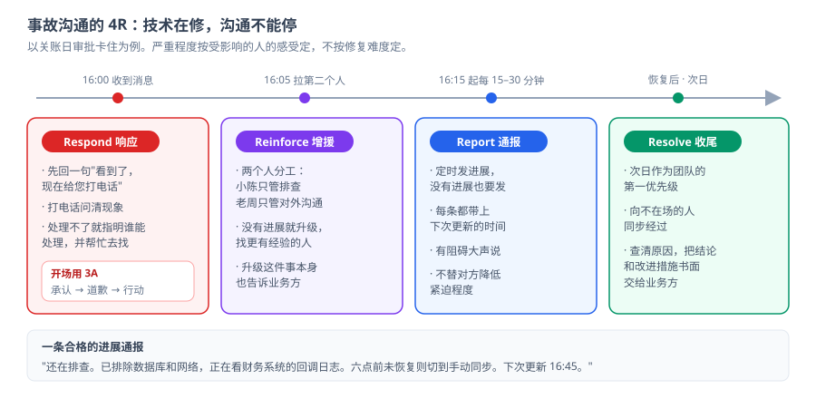

## 前言

月末最后一个工作日，下午四点。财务部王经理在项目群里发了一条消息：

> "报销审批又卡住了，点通过一直转圈。今天是关账日，一百多张单子等着批。你们这系统到底行不行？"

小陈第一个看到。他查了一眼监控，回复：

> "王经理，我看了一下，接口本身没问题，是财务系统那边的回调变慢了，不是我们的原因。"

小陈说的是事实。慢的确实是对方系统的回调。但王经理看到这句话，火气更大了：他不关心是谁的原因，他关心的是一百多张单子今天批不完。

这是技术人员最容易踩的一个坑：**被指责时，第一反应是澄清责任。**澄清本身没有错，错在顺序。对方带着情绪和一个急需解决的问题来，得到的第一句回复是"不怪我"。

应对这种场面，有两个可以直接套用的框架。一个管"被批评时怎么回话"，一个管"出事故时怎么沟通"。

## 一、3A：承认、道歉、行动

接受批评或投诉时，按三步回应。三个词的英文都以 A 开头：Acknowledge、Apologize、Action。

**承认（Acknowledge）**：确认问题确实发生了，让对方知道你明白他的处境。

> "王经理，审批一直转圈的情况我们看到了，现在确实批不动。"

**道歉（Apologize）**：为对方遭遇的麻烦道歉。即使原因不在你。

> "关账日遇到这种情况，耽误你们的工作了，很抱歉。"

**行动（Action）**：说明现在做什么，之后怎么避免。

> "我现在给您打电话。小赵同时在联系财务系统的运维。十五分钟内给您一次进展。"

三句话连起来不到一百字，没有一句涉及"是谁的问题"。

### 不是我的错，为什么要道歉

这是 3A 里最让技术人员抵触的一步，尤其是在习惯把"道歉"等同于"认错担责"的环境里。

这里道歉的对象是**对方的处境**，不是**事故的责任**。"耽误您工作了，很抱歉"和"是我们的代码写错了"是两句不同的话。前一句在任何情况下都成立：对方确实被耽误了，而你是他此刻能找到的人。

站在对方的角度想一下：系统是你们团队交付的，他不知道也不需要知道背后有几个系统、哪个归谁。他需要听到的是三件事：你们知道了，你们在意，你们有办法。

责任归属当然要讲清楚，但那是事情解决之后、复盘时的内容。那时候拿出时间线和日志，心平气和地说明"回调延迟来自财务系统，我们这边会加超时降级"，对方完全听得进去。在对方最着急的时候抢着澄清，再充分的事实也只会被听成推卸。

### 日常的批评同样适用

3A 不限于事故。评审意见、客户反馈、同事的抱怨，都可以这样回应。

老周在评审里指出小赵的 PR 漏了驳回原因的必填校验：

> ❌ "需求文档里没写这条啊。"
>
> ✅ "确实漏了（承认）。给你多添了一轮评审，不好意思（道歉）。我现在补上，另外回头把需求里所有'必须'的条目过一遍，看还有没有漏的（行动）。"

需求文档如果确实没写清，在"行动"里提出来："另外我发现需求里没有写这条，我去跟岚姐确认一下，把文档补上。"同一个事实，放在行动里说是在解决问题，放在第一句说是在辩解。

## 二、4R：响应、增援、通报、收尾

线上事故发生时，技术上怎么修是一条线，对相关的人怎么沟通是另一条线。后者常常被忽略：工程师埋头排查，业务方在群里一遍遍问"怎么样了"，没人回答。

事故沟通分四个阶段：Respond、Reinforce、Report、Resolve。

先明确一个前提：**事故有多严重，由受影响的人说了算，而不是由修复难度决定。**对工程师来说，"回调变慢"也许只是一个小问题；对关账日的财务部来说，这是全天最大的事。按对方的严重程度来对待。

### 响应（Respond）

看到消息立刻回应，不要等查清楚了再说话。

- **先回一句最短的话。**"看到了，现在给您打电话。"这句话的作用是让对方知道有人接手了。
- **打电话，不要只在群里打字。**电话里一分钟能问清的现象，文字要来回十轮。
- **用 3A 开场。**承认、道歉、说明马上要做什么。
- **自己处理不了，就指明谁能处理，并且帮忙去找。**"这个要找运维的同事，我现在去联系，联系上了回来告诉您。"而不是一句"这个不归我管"。

### 增援（Reinforce）

尽早拉第二个人进来，两个人分工：**一个人修，一个人负责沟通。**

排查问题需要整段不被打断的注意力，而业务方每隔几分钟就需要一次回应。一个人同时做这两件事，两件都做不好。

小陈排查，老周负责对接王经理。小陈不看群，老周每隔一阵去问小陈进展，转成业务方听得懂的话发出去。

排查没有进展时，立刻升级，找更有经验的人或者对方系统的负责人，并且把"我们已经升级了"告诉业务方。不要一个人闷着试。

### 通报（Report）

**每 15 到 30 分钟通报一次，即使没有进展。**

"还在排查，已经排除了数据库和网络，正在看财务系统的回调日志，下次更新 16:45"——这样一条消息没有任何好消息，但对方知道事情在推进，知道下一次什么时候有消息，就不会每隔两分钟来问。

没有消息的时候，人会自动往最坏的方向想。沉默二十分钟，在等待的人看来就是"没人管"。

另外两点：

- **有阻碍就大声说。**需要对方系统的人配合而联系不上，直接告诉业务方，对方往往有你没有的渠道。
- **不要替对方降低紧迫程度。**

> ❌ "现在快下班了，周一再看吧。"
>
> ✅ "今天六点前如果回调还没恢复，我们先切到手动同步，保证单子今天能批完。回调的根本原因周一上午继续查。"

### 收尾（Resolve）

系统恢复不等于事情结束。

- **下一个工作日，把它作为团队的第一优先级。**先处理这件事，再做其他安排。
- **向当时不在场的人同步经过。**
- **启动原因调查，并把结论告诉业务方。**发生了什么、为什么、以后怎么避免。

最后一条是把 3A 的"行动"补完整。事故当时承诺的"之后怎么避免"，要有一个书面的结果交给对方。王经理最终收到的是一段话：回调延迟的原因、已经加上的超时降级、下个月关账日前会做一次压测。

到了这个时候，再说明"根因在财务系统的回调"，王经理的反应是："原来是这样，那我也去找他们负责人说一下。"

## 小结

| 场合 | 框架 | 要点 |
|---|---|---|
| 被批评、被投诉 | 3A | 承认 → 为对方的处境道歉 → 说明行动；责任归属留到复盘 |
| 线上事故 | 4R | 立刻响应 → 两人分工 → 定时通报 → 次日收尾并交付结论 |

两个框架背后是同一个原则：**先处理对方的处境，再处理事实的归属。**
