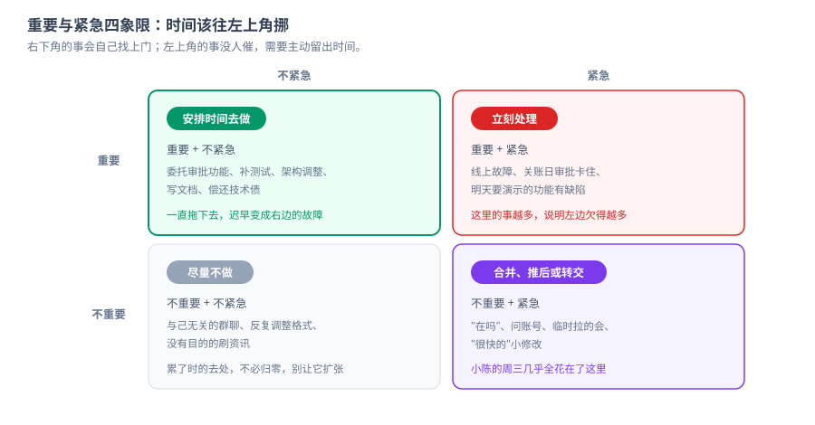
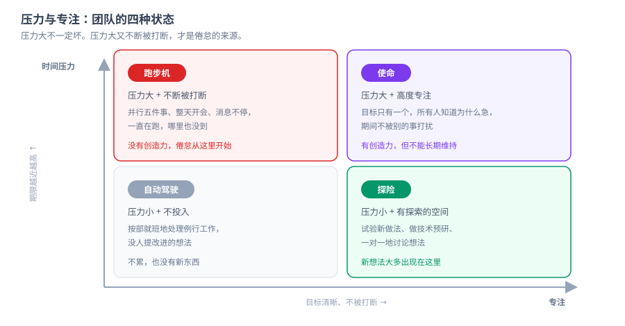

## 前言

小陈周三的计划只有一件事：把"委托他人审批"的功能写完。这个功能已经拖了两个迭代，每到月末审批人出差，就有一批单子卡住。

实际的一天是这样过的：

- 9:20 刚打开编辑器，群里有人 @ 他问测试环境的账号。
- 9:50 王经理发来消息，问某张报销单为什么显示"待审批"。查了二十分钟。
- 10:40 岚姐说有个文案想改一下，"很快的"。
- 11:30 小赵来问接口字段。
- 14:00 临时被拉进一个评审会。
- 15:30 群里讨论午饭报销标准，他回了几条。
- 17:00 发现一封未读邮件，回到一半又被叫走。

下班时，委托审批的代码写了二十行。小陈一整天没闲着，回头想却说不清做了什么。

**忙和有产出是两回事。**这一天里每一件插进来的事都显得合情合理，问题在于它们全都排在了那件真正重要的事前面，而且没有任何人做过这个排序的决定。

## 一、四象限：紧急的事会自己找上门

把任务按"重要"和"紧急"两个维度分开，得到四个象限。这个方法通常被称作艾森豪威尔矩阵。

放到软件开发里，两个词可以这样定义：

- **紧急**：有外部的时间压力。有人在等、有期限、有故障。
- **重要**：对结果影响大，哪怕没有任何期限。架构设计、充分的测试、核心功能、偿还技术债。

小陈的一天几乎全花在了右下角：紧急但不重要。账号问题、文案修改、群里的讨论，每一件都有人在等，每一件单独看都不值得推掉。

而"委托审批"在左上角：重要但不紧急。没有人今天催它，所以它永远排在后面，直到下一个月末，它变成一次故障，跳进右上角。

**紧急的事会自己找上门，重要的事需要主动留出时间。**四象限的用处，是在一件事插进来的时候多问一句：它是真的重要，还是只是有人在等？

一个可以拿来练手的问题：同时收到两条消息，一条是财务提醒你本月的工时还没填，一条是市场部想换首页的图标。先做哪个？工时关系到整个部门的结算，有截止日期；图标既不紧急，重要程度也有限。很多人却会先做图标，因为它更有意思，也因为提的人催得更勤。

## 二、有人插队时，先确认顺序

塔台的管制员面前有四架飞机排队等待降落，这时第五架进入空域。管制员不会因为第五架是最新出现的，就让它先降。

工作里却常常如此：**最新来的任务，自动变成了最优先的任务。**消息弹出来，手上的事就放下了。

新任务插进来的时候，不要默默接下，也不要默默搁置，说一句话：

> "我现在在做委托审批，计划今天提测。这个文案修改要排到它前面吗？"

这句话把排序的决定权交还给了有权排序的人。岚姐可能说"文案不急，明天也行"，也可能说"文案今天必须改，客户下午要看"。无论哪种回答，顺序都是被明确决定的，而不是被消息的先后顺序决定的。

很多人不这么问，是觉得反问显得不配合。实际上，岚姐并不知道你手上有什么，她说"很快的"时，默认你是空闲的。让她知道代价，她才能做出正确的判断。

配套的三个习惯：

- **有一份写下来的优先级清单。**不必复杂，任务看板或者一个置顶的文档都可以。有了它，"现在该做什么"不需要每次重新思考。
- **团队约定一个"紧急"标记。**比如消息以"【紧急】"开头，表示需要放下手头的事立即处理。这个标记只留给线上故障这一类事，滥用几次就没人理会了。
- **确认过的调整，同步给相关的人。**委托审批因此推迟一天，告诉等着它的人。

## 三、对付干扰

干扰分两种：别人带来的，和自己带来的。

**减少别人的打断：**

- **把被反复问到的问题写成文档。**测试环境的账号在哪、报销单状态各是什么含义，写一次，以后回一个链接。小陈一天里有两次打断属于这一类。
- **在状态里写明自己在做什么。**企业微信、钉钉、飞书都可以设置状态。"专注开发中，16 点后回复"，让别人知道现在不是好时机，也知道什么时候可以找你。
- **不紧急的事不发即时消息。**需要讨论的、需要留档的，写邮件或者写进任务评论。

国内还有一种特有的打断方式："在吗？"发出这两个字的人在等回复，收到的人不知道是什么事，只能放下手头的工作回一句"在"，然后继续等。**把要说的事一次说完**："在吗"换成"小陈，测试环境的管理员账号是哪个？不急，有空回我"，对方可以自己安排处理的时间。

**减少自己的分心：**

- **一次只做一件事。**打开一封邮件，回到一半，又去看另一封，结果两封都没处理完。做完一件，归档，再开下一件。
- **关掉非必要的通知。**群消息设成免打扰，只保留 @ 自己的提醒；开会时手机静音。
- **用固定的时间块工作。**番茄工作法是一种现成的做法：专注 25 分钟，休息 5 分钟。时长不重要，重要的是这段时间里不看消息。
- **浏览器的新标签页设成空白页。**一打开就是资讯和推荐，注意力还没开始工作就被带走了。

集中处理消息也是一个办法：每小时看一次，而不是每条都看。真正紧急的事，对方会打电话。

## 四、团队的四种状态

把视角从个人拉到团队。哈佛商业评论上有一项关于时间压力与创造力的研究，按"压力"和"专注"两个维度，把团队的工作状态分成四种：

- **使命**：压力大，但目标清晰、不受打扰。像阿波罗 13 号上，工程师用舱内现有的零件拼出一个二氧化碳过滤装置。人在这种状态下有创造力，并且觉得自己做的事有意义。
- **探险**：压力小，有探索的空间。新想法大多在这种状态下出现。
- **跑步机**：压力大，同时不断被打断。一直在跑，哪里也没到。这是倦怠的来源。
- **自动驾驶**：压力小，也不投入。按部就班，没有新东西。

小陈的周三是标准的跑步机状态。如果整个团队长期处在这个象限，表现出来就是：每个人都很忙，交付却越来越慢，没有人提改进的想法。

研究里还有一个容易被忽视的结论：**压力的影响会延续。**赶完一次工期之后的几天里，创造力仍然处于低位。接连不断地冲刺，团队就没有恢复过来的时候。

把团队拉出跑步机，有几个具体的办法：

- **设定无会议、无消息的时间段。**比如每天上午十点到十二点不开会、不 @ 人。约定要团队一起遵守才有效。
- **讨论问题尽量一对一，少开大会。**八个人的会上，真正在思考的通常只有两三个。
- **留出试验的时间。**3M 公司允许员工把 15% 的时间花在自己选的项目上。小团队做不到这个比例，每个迭代留半天也好。
- **避免不现实的期限和过多的并行任务。**一个人同时挂着五件事，等于每件事都在排队。

## 小结

- 一件事插进来，先分清它是重要，还是只是有人在等。
- 被插队时问一句："要把它排到我手上这件事前面吗？"
- 被反复问的问题，写成文档，以后回链接。
- 每天给重要但不紧急的事留一段不被打扰的时间。
- 团队长期处于"忙而不专注"时，先减少打断，再谈提速。

给探索性的任务设时间上限的做法，见[卡住之后的几条时间线](/2026/10/09/team-rules-unblock/)。
