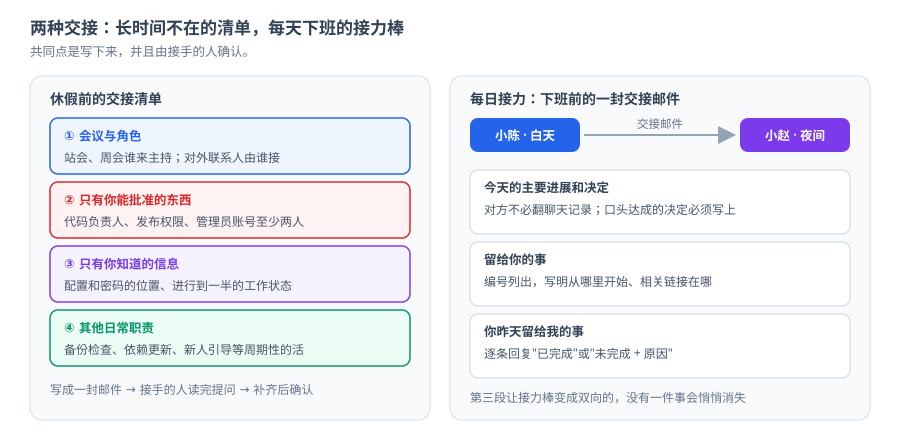

## 前言

小陈攒了一年的年假，带家人去了三亚。第二天下午，他正在海边，手机响了。

"小陈，预发布环境的数据库密码是多少？配置文件里那个不对。"

十分钟后又一个："审批模块的 PR 只有你能批，小赵的修复卡着合不进去，你能上线点一下吗？"

第三天是周会，没人主持，因为平时是小陈在主持。

小陈的假期变成了远程值班。同事们也不好受，每打一个电话都带着歉意。

有一个简单的判断标准：**休假期间被同事打电话找，多半说明交接没做好。**这句话不是在责怪谁，它指向的是一个可以提前解决的问题。人总会不在：休假、生病、出差、调岗、离职。团队能不能在某个人不在的时候照常运转，取决于他在的时候留下了什么。

## 一、休假前的交接清单

交接的内容因人而异，但可以从四个方面逐项过一遍。

**1. 你主持的会议和承担的角色**

站会、周会、评审会由谁代为主持，还是改期。你是某件事的对外联系人，这段时间由谁接。

**2. 只有你能批准的东西**

ExpenseFlow 的审批模块在仓库里设了代码负责人，原本只有小陈一个人：

```text
# CODEOWNERS
/src/ExpenseFlow.Api/Approval/   @chen
```

这意味着小陈不在，审批模块的任何改动都合不进去。改成至少两个人：

```text
# CODEOWNERS
/src/ExpenseFlow.Api/Approval/   @chen @zhou
```

**任何一个区域都不应该只有一个负责人。**这条不只是为休假准备的，平时就应该如此。同样的检查适用于：发布权限、云平台的管理员账号、域名和证书的管理权限、第三方服务的登录账号。

**3. 只有你知道的信息**

密码和配置在哪里（应该在密码管理工具或密钥服务里，而不是在某个人的脑子里）、手上进行到一半的工作各自处于什么状态、最近答应过别人什么。

**4. 其他日常职责**

每周的数据备份检查、每月的依赖更新、新同事的入职引导，这些没有写在岗位职责里、但一直是你在做的事。

把这四项写成一封交接邮件，发给接手的人，并**请对方确认**。对方读一遍，往往能问出你漏掉的东西："预发布的数据库密码现在放在哪？"这个问题在出发前被问到，比在海边被问到好得多。



## 二、每日接力：人不同时在线的协作

休假是偶尔的不在场。有些团队的常态就是不同时在线：国内团队服务海外客户，和外包团队分处两地，或者有人上早班有人上晚班。

这种协作可以想成接力赛：每个人跑完自己的一段，把接力棒交到下一个人手里，比赛不停。交接棒就是每天下班前的一封交接邮件。

模板很短：

```text
主题：ExpenseFlow 每日交接 - 11 月 2 日

小赵，接力棒交给你。

【今天的主要进展和决定】
- 委托审批的接口已完成并合并，接口说明在 PR 描述里
- 和岚姐确认：委托期限最长 30 天，超过需要重新设置

【留给你的事】
1. 委托审批的前端页面，可以开始联调了
2. 导出功能的评审意见有 3 条待处理

【你昨天留给我的事】
1. 字段命名确认 —— 已完成，按你的方案
2. 测试环境账号 —— 未完成，等运维回复，明天继续跟
```

三个部分各有用处：

- **进展和决定**：对方不必翻聊天记录，就知道今天发生了什么变化。尤其是"决定"，口头达成的共识，不在场的人无从得知。
- **留给对方的事**：明确接下来该做什么，不需要猜。
- **对方留给自己的事**：逐条回复完成或未完成。有了这一段，接力棒才是双向的，没有一件事会悄悄消失。

如果两边的工作时间有一小段重叠，把它留给需要实时讨论的事，而不是用来同步进度。进度靠邮件，重叠时间用来解决问题。

即使所有人都在同一个办公室，这个习惯在一种场合下同样有用：一件事从一个人手里转到另一个人手里的时候。

## 三、让别人知道你在哪

很多打断和等待，起因只是不知道对方在不在。

"老周今天在吗？""他下午是不是有会？""小陈是不是休假了？"每一个这样的问题，都可以由日历来回答。

- **设置工作时间。**日历里标明每天的工作时段，跨地区协作时尤其重要。
- **日历对同事可见。**至少能看到忙闲状态，约会议时不需要逐个去问。
- **不在的时间提前写进去。**休假、外出、培训，都建成日程。团队有共享的请假日历就同步一份。
- **保持准确。**一个经常和实际情况不符的日历，比没有日历更糟，因为它让人做出错误的安排。

请假尽量提前告知。提前两周说，团队可以调整排期；前一天说，只能有人临时顶上。

## 四、变化发生时，告诉大家

团队里的信息，默认是传不到每个人那里的。

规范改了一条，只在三个人的讨论里提过；新同事入职，过了一周还有人不知道他负责什么；某个接口下线了，调用方是从报错里发现的。

有变化的时候，在团队的公共频道里发一条消息：

- **规范或流程的更新**，附上链接和一句话说明改了什么、为什么改。
- **人员的变动**：谁加入了、谁调走了、职责怎么调整。
- **会影响别人的技术变更**：接口变更、环境调整、计划内的停机。
- **自己较长时间的外出**，写明期间由谁代理、紧急情况怎么联系。

不只是工作上的事。结婚、添丁这样的好消息，同样值得说一声。团队不只是一起干活的一群人。

## 五、删改别人的东西之前，先说一声

共享的文档、wiki、配置、代码里的大段注释，人人都可以改。但动手之前有一条基本的礼节：**对别人写的内容做大幅修改或删除，先告诉原作者。**

小赵整理项目文档时，发现"常见问题"里有一节讲的是旧版审批流程，已经不适用了。他有两种做法：直接删掉；或者先找写这一节的小陈说一声。

先说一声的好处有三个。小陈也许知道这一节还有人在用，比如老客户的私有部署还是旧流程；小陈的工作得到了尊重，没有人愿意某天发现自己写的东西无声无息地消失了；日后有人问"那一节去哪了"，有据可查。

口头说完，再留一条书面记录：

> "小陈，按我们刚才聊的，我把'常见问题'里关于旧版审批流程的一节移除了，原因是 2.0 之后流程已经变更，内容不再适用。老客户私有部署用的说明我挪到了 `docs/legacy/` 下。抄送老周和岚姐知悉。"

版本控制能告诉你谁在什么时候删了什么，但不能告诉你为什么。这条消息补上的就是"为什么"。

## 小结

出发休假前，对照检查：

- 我主持的会、我对接的人，有人接手了吗？
- 有没有哪个权限、哪块代码、哪个账号只有我一个人能动？
- 手上做到一半的事，状态都写下来了吗？
- 交接邮件发出去了吗，接手的人确认了吗？
- 日历上标了吗，团队知道我哪天回来吗？

五条都做到，假期里手机应该是安静的。
