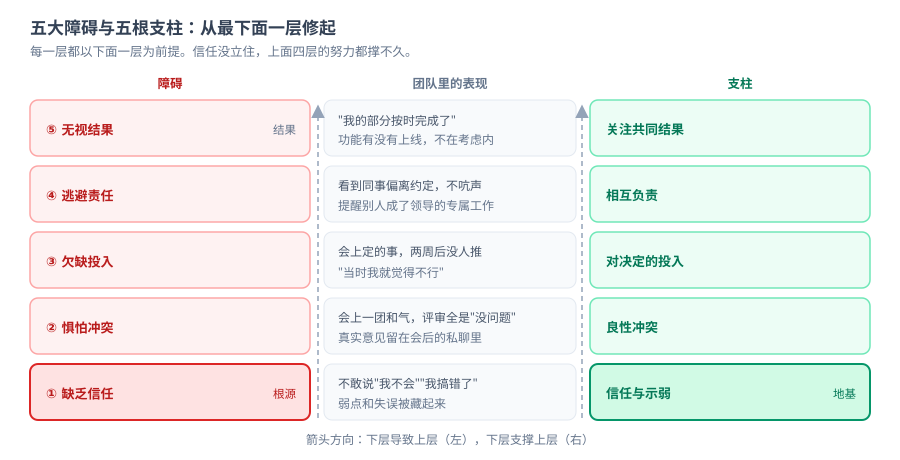

## 前言

有一种团队，表面上挑不出毛病。

周会气氛融洽，没有人争论。老周提出方案，大家点头。代码评审清一色的"没问题"。每个人都客客气气，从不红脸。

但是，会上定下来的事，两周后发现没人在推。上线延期了，每个人都能说清楚"我这部分是按时完成的"。同一个问题在三次复盘里出现了三次。

这种状态有个现成的词：一团和气。它常被当成团队氛围好的标志，实际上往往相反。**没有争论的团队，通常不是因为意见一致，而是因为大家觉得说了没用，或者说了有风险。**

## 一、五大障碍：一层压着一层

帕特里克·兰西奥尼在《团队协作的五大障碍》里把这种状态拆成了五层。它们不是并列的五个问题，而是一条因果链，下面一层没解决，上面一层就无从谈起。

从最底层往上看：

**第一层：缺乏信任。**这里的信任有特定的含义：敢不敢在同事面前示弱。能不能说出"这个我不会""这个是我搞错了""我需要帮忙"。如果说出这些话会被看轻、被记上一笔，大家就会把弱点藏起来。

**第二层：惧怕冲突。**彼此不信任，就不敢把真实的想法摆出来争。会上的沉默不代表同意，只代表不想惹麻烦。真正的意见留到了会后的私聊里。

**第三层：欠缺投入。**一个方案没有经过充分的争论，持不同意见的人就没有真正接受它。他们不会反对，但也不会全力去做。"当时我就觉得不行"是这一层的标志性台词。

**第四层：逃避责任。**对决定没有投入感，就不会用它来要求自己，更不会去提醒别人。看到同事的做法偏离了约定，心想"又不是我定的，关我什么事"。

**第五层：无视结果。**没有人对共同的目标负责，每个人就退回去守自己的那一块。"我的接口按时交了"成了终点，至于整个功能有没有上线，不在考虑范围内。

回到开头的团队，对号入座：评审清一色的"没问题"是第二层，定了的事没人推是第三层和第四层，"我这部分按时完成了"是第五层。而根子在第一层。

## 二、五根支柱：把每一层翻过来

每一层障碍翻过来，就是健康团队的一项特征。

| 障碍 | 对应的支柱 | 可以从哪一件事做起 |
|---|---|---|
| 缺乏信任 | 信任与示弱 | 负责人带头说"这个我判断错了" |
| 惧怕冲突 | 良性冲突 | 做决定前，点名请还没说话的人发表看法 |
| 欠缺投入 | 对决定的投入 | 会议结束前，把决定和负责人复述一遍 |
| 逃避责任 | 相互负责 | 同事之间可以直接提醒，不必事事经过领导 |
| 无视结果 | 关注共同结果 | 站会上先问"功能离上线还差什么"，再问个人进度 |

逐项展开。

**信任与示弱。**信任不是靠团建喝出来的，是靠一次次"说了实话也没事"的经历攒出来的。最有效的起点是职位最高的人先示弱。老周在周会上说一句"上次坚持用轮询是我判断错了，应该听小赵的用消息推送"，比任何关于"大家要敢于承认错误"的号召都管用。

**良性冲突。**冲突有两种：对事的和对人的。良性冲突是围绕方案、取舍、优先级的争论，越充分越好。在讲究"以和为贵"的环境里，这需要有人主动创造条件：

- 做决定之前，点名问那些还没说话的人："小陈，你一直没说话，你怎么看？"
- 指定一个人专门找方案的毛病。有了这个角色，反对意见不再是"跟谁过不去"。
- 把"有没有人反对"换成"这个方案最可能在哪里出问题"。前一个问题的默认答案是沉默。

**对决定的投入。**充分争论的目的不是达成一致，而是让每个人的意见被听到。被听到之后，即使最终的决定和自己的主张不同，多数人也能接受并且执行。这就是常说的"保留意见，全力执行"。

会议结束前花一分钟："今天定的是三件事：一、二、三，分别由谁负责，什么时候完成。有人理解得不一样吗？"这一分钟能消除大半的"我以为"。

**相互负责。**多数团队里，提醒别人"你答应的事还没做"是领导的专属工作。健康的团队里，同事之间可以直接说："联调文档说好周三给，今天周四了，卡着我这边了。"这在国内的职场文化里是最难的一条，因为它容易被理解成"你算老几"。前提是前三层已经立住：大家彼此信任，决定是共同做出的，提醒才会被听成对事情负责，而不是越位。

**关注共同结果。**把团队的目标放在个人的指标之前。一个简单的检验：功能延期的时候，团队成员的第一反应是"我的部分做完了"，还是"我能帮上什么"。

## 三、仆人式领导：负责人的工作是清障

五根支柱的每一根，都离不开团队负责人的做法。与之匹配的领导方式叫作仆人式领导（Servant Leadership）：**负责人为团队服务，而不是团队为负责人服务。**

"仆人"这个词直译过来有些别扭，换成熟悉的说法就是"搭台子的人"。它有三个特征：

- **挡住不必要的外部压力。**需求的反复、来自上面的催促、其他部门的临时要求，由负责人先过滤一遍，不原样倾倒给团队。
- **把业务目标翻译成清晰的技术任务。**"财务希望月底关账顺利一点"是业务目标，"二级审批支持委托，月底前上线"才是团队可以动手的东西。
- **用团队的产出衡量自己，而不是用自己的产出。**

第三条对刚从技术骨干提拔上来的组长最难。老周写代码是团队里最快的，当了负责人以后，他的本能仍然是把最难的模块留给自己。结果是：他成了所有人的瓶颈，评审排队等他，问题排队等他，而他自己埋在核心代码里抬不起头。

负责人的工作排序应该是：

1. 帮团队成员解除阻塞
2. 随时可以被找到，回答问题
3. 把接下来的需求梳理清楚
4. 还有剩余时间，再写代码，并且只挑随时可以放下的任务

**带的是人，不只是项目。**除了问"进度怎么样"，定期问三个问题：

> "有什么是我可以帮你的？"
>
> "现在什么事情在拖慢你？"
>
> "哪一块让你觉得心里没底？"

**管方向，不管细节。**

> ❌ "这个功能就按我说的这么写，别问为什么。"
>
> ✅ "委托审批是这个迭代的第一优先级，月底必须能用。具体怎么实现，你们有什么想法？"

前一种说法得到的是执行，后一种得到的是投入。方案是自己提的，人会对它负责到底。

**让人敢说实话。**

- 有人承认错误时，先谢谢他说出来，再谈怎么补救。
- 不追究"谁的错"，追究"流程哪里有洞"。
- 不说"我早就说过"。这句话除了让对方下次闭嘴，没有任何作用。
- 团队遇到问题时，忍住第一时间出手的冲动，让他们先自己解决。负责人次次救火，团队就学会了等人来救。

## 四、同理心：三个方向

把上面这些做法串起来的能力是同理心：站到对方的位置上想一想。它在技术团队里经常被低估，被归为"软"的东西。

**对上和对客户。**理解产品负责人或客户背后的目标和压力。岚姐反复改需求，可能是因为财务部也在反复改主意。理解了这一点，你提的建议会从"能不能别改了"变成"我们要不要一起去跟财务把规则一次定下来"。

**对同事。**技术圈里有一种人：能力出众，但没人愿意跟他合作。评审时言辞刻薄，讨论时居高临下。短期内他的产出很高；长期看，当与他共事的痛苦超过了他的产出，机会就不再找上他。反过来，大家愿意共事的人，会不断被人拉进新的项目。

**对下属。**每个人需要的东西不一样。有的人需要一句肯定，有的人需要在卡住的地方被点拨一下，有的人需要的只是不被打扰。因为怕让领导失望而工作的人，做到及格线就停了；觉得自己被尊重、被听见的人，会主动多走一步。

## 小结

诊断一个团队处在哪一层，可以问五个问题：

- 上一次有人在会上说"我搞错了"是什么时候？
- 上一次会上出现真正的争论是什么时候？
- 会上定下的事，两周后还有几件在推进？
- 同事之间会直接提醒对方"你答应的事还没做"吗？
- 功能延期时，大家说的是"我的部分做完了"，还是"我能帮上什么"？

从答不上来的最下面一层开始修。
