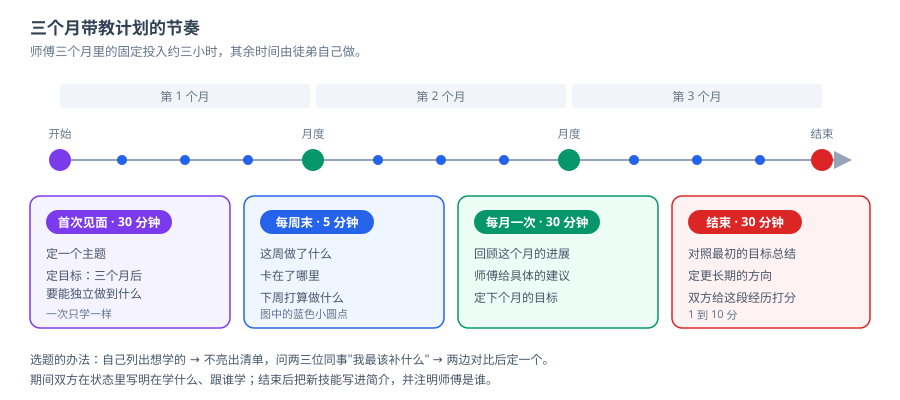

## 前言

小赵入职 ExpenseFlow 团队的第一周，收到了一份入职清单：十二篇文档、三门视频课、一个代码仓库的地址。

他很认真，文档逐篇读完，视频看了两遍。一个月后，他仍然不敢碰审批模块。文档告诉了他系统有哪些部分，没有告诉他改一行代码之前该先看哪里、哪些地方一动就出事。

后来老周换了个办法：每周挑一个审批模块的小缺陷，两个人坐在一起改。老周不动键盘，只在小赵犹豫的时候说一句"先看看这个方法有几处调用"。两个月后，小赵独立完成了委托审批的前端。

这个办法在国内有个老名字，叫"师傅带徒弟"，或者"传帮带"。技术行业每隔几年就要换一批工具，新人要学，老人也要学。看书、看视频、读文档都有用，但效果最好的学习方式，是有一个有经验的人定期带着你一起做。

## 一、谁可以当师傅

提到师傅，多数人想到的是资历更深、职位更高的人。这个理解窄了。

**师傅不必更资深，只需要在某一件事上比你强。**小赵入职不久，但他对前端的新工具链比老周熟得多。老周带小赵熟悉审批业务，小赵教老周配置新的构建工具，两件事同时在发生。每个人都有可以学的东西，也都有可以教的东西。

一位师傅能提供的，不只是知识：

- 卡住的时候点拨一下，省掉几个小时的弯路
- 指出该看哪份资料，而不是让你自己在一百篇文档里找
- 做重要决定之前，有一个可以商量的人
- 在你怀疑自己的时候，告诉你这是正常阶段

好师傅的共同点可以归成几条：

- **会把你往舒适区外推一步。**不是把活替你干了，而是让你自己干稍微难一点的。
- **给具体的反馈。**做得好的地方说出来，有问题的地方也说出来。
- **舍得花时间。**带人需要固定的投入，挤牙膏式的指点效果有限。
- **自己还在学。**一个停止学习的人，能教的东西很快就过时了。
- **坦诚。**包括承认"这个我也不知道"。

## 二、三个月的带教节奏

"有空多带带他"这种安排，结果通常是没空。带教需要一个明确的节奏。

**先选题，一次一个。**主题可以是技术，也可以不是：EF Core 的性能调优、云上的架构设计、怎么做技术分享、怎么跟业务方沟通。选题有一个好用的办法：

1. 自己列出想学的东西。
2. 不给别人看这份清单，去问两三位信得过的同事："你觉得我最该补的是什么？"
3. 把两边的答案放在一起比较，定一个。

第二步经常带来意外。自己想学的是新框架，同事普遍觉得你该补的是"把方案讲清楚"。

**再定节奏，以三个月为一期。**

| 时间点 | 时长 | 内容 |
|---|---|---|
| 首次见面 | 30 分钟 | 定目标：三个月后要能独立做到什么 |
| 每周末 | 5 分钟 | 快速对一下：这周做了什么，卡在哪 |
| 每月一次 | 30 分钟 | 回顾进展，给建议，定下个月的目标 |
| 结束时 | 30 分钟 | 总结，定更长期的方向，给这段经历打个分（1 到 10） |

两点值得注意。每周只有五分钟，其余时间是徒弟自己做，师傅的投入可控，才能持续。结束时的打分是双向的反馈，下一期据此调整。

**让它被看见。**双方在即时通讯工具的状态里写一句"正在学习 EF Core 性能调优，师傅：老周"。别人知道你在学什么，遇到相关的问题会来找你，这本身就是练习的机会。一期结束，徒弟把新技能加进自己的简介，并且写明是跟谁学的。对师傅来说，这是一份公开的感谢。

如果想学的东西团队内部没人会，就向外找：请外部的顾问或者有经验的同行，集中带几天。

## 三、每周分享一个点子

带教是一对一的，分享是一对多的。

给自己定一个小目标：**每周至少分享一个有用的东西。**一个快捷键、一个调试技巧、一个踩过的坑、一段好用的提示词。发在团队群里，或者写进团队的知识库，几行字就够。

这件事对团队的好处显而易见：知识不再只装在某一个人的脑子里，任何人休假或离开，团队的能力不会跟着走。3M 的前董事长威廉·麦克奈特说过，公司要持续成长，就必须有很多有主动性的人。

对个人的好处往往被一句老话挡住了：**"教会徒弟，饿死师傅。"**

这句话在手艺只能靠口传心授、一个镇上只养得活一个木匠的年代是成立的。放在今天的技术团队里，逻辑正好相反：

- **不可替代的人，也是不能提拔的人。**某个模块只有你懂，你就只能留在那个模块上。
- **不可替代的人，没法安心休假。**每一个只有你知道的东西，都是一个会在假期里响起的电话。
- **技术在贬值，教的能力在升值。**你捂着的那点东西，两年后多半已经过时；而"这个人能把团队带起来"的评价，会一直跟着你。

把自己的想法说出来、被采纳，还会带来信心。分享越多的人，越愿意继续贡献想法。这件事不分职位，不是只有管理者才该做。

## 四、长板的陷阱

有句话叫"手里拿着锤子，看什么都像钉子"。每个人都有几样自己最拿手、也最引以为傲的特质：逻辑强、独立、随和、有韧性。它们帮你走到了今天，所以你会一用再用，直到它们成了唯一的工具。

任何一个长处，用过了头都有反面：

| 长处 | 用过头的样子 |
|---|---|
| 逻辑强、注重细节 | 争论时非要分出对错，赢了道理，丢了大局 |
| 独立 | 不肯求助，一个人卡两天 |
| 随和 | 回避必要的冲突，该拒绝的不拒绝 |
| 有韧性 | 不肯示弱，硬撑到出问题 |
| 负责 | 什么都自己扛，不放手让别人做 |
| 忠诚 | 明知不合适的合作，迟迟不肯结束 |

技术人员最常见的是第一行和第二行。一个靠"逻辑严密"立足的工程师，在评审里很容易把每一次讨论都变成辩论赛。

这些特质难以松动，是因为它们已经成了自我认同的一部分："我就是这样的人。"而它们多半形成得很早，源于年少时某一次觉得自己不够好、不被接纳的经历：从此决定要靠成绩证明自己，或者要靠懂事讨人喜欢。一个在很小的时候做出的决定，谈不上周全，却被一直沿用到了今天。

应对的办法分三步：

1. **认出自己的长板。**问自己：我最欣赏自己哪一点？一路上帮我最多的是什么？
2. **想一想它用过头是什么样。**对照上面的表，或者直接问身边的人。
3. **在当下察觉，并换一种做法。**这是最难的一步。评审里又想争到底的时候，停一下，问自己："这一次，重要的是我对，还是事情办成？"

当下没察觉到，事后想明白了也有用。知道了缘由，回头道个歉、换个方式重来，会容易得多。

这和带教有直接的关系。师傅的价值之一，就是指出那些你自己看不见的东西，而长板的反面恰恰是自己最难看见的。

## 五、说出偏好，也接受没意思的活

成长还取决于做什么样的工作，而这一点，很多人从不开口。

小赵想多做前端架构，不太想写报表。他从没跟老周说过，理由是"领导应该看得出来"。老周手下有好几个人，每个人的偏好他不可能都记得，更谈不上猜。

**明确告诉负责人，你想做哪一类工作，不太想做哪一类。**并且隔一段时间再说一次，因为他会忘。

> "接下来如果有前端架构方面的工作，我很想参与。报表类的我可以做，但如果有其他人选，我更希望把时间放在架构上。"

这句话说的是偏好，不是条件。说完之后，有一半的可能，下一个任务仍然是报表。

这时候的做法是：接下来，做好。每个项目都有没人想做的部分，总得有人做。把没意思的活干得漂亮的人，下一次提出偏好的时候，分量是不一样的。

反过来，对负责人来说，分配任务时尽量照顾偏好，实在照顾不到的时候说明原因："这次报表还得你来，因为月底前只有你熟悉这套数据。下个迭代的组件库重构留给你。"

## 小结

- 找一位师傅，定一个主题，按三个月一期的节奏推进。
- 也去当别人的师傅，哪怕只在一件小事上。
- 每周分享一个有用的东西。
- 认出自己最得意的长处，留心它用过头的时候。
- 把想做的工作说出来，也把分到手里的工作做好。

团队里的每一条规则，最后都要落到人身上。人在成长，规则才用得起来，这也是[规则需要不断被质疑和修订](/2026/09/22/team-rules-why-rules/)的原因。
