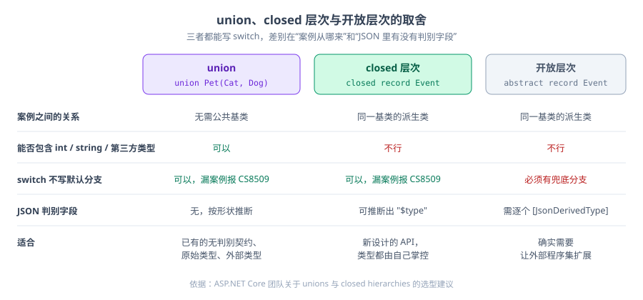

### 前言

[C# 15](https://learn.microsoft.com/dotnet/csharp/whats-new/csharp-15?wt.mc_id=MVP_324329) 随 .NET 11 正式发布，`union` 与 `closed` 是其中分量最重的两项。Preview 阶段它们需要 `<LangVersion>preview</LangVersion>`；到了 GA，只要项目以 `net11.0` 为目标就默认可用，System.Text.Json、Minimal API、SignalR 和 OpenAPI 也同步给出了支持。

Preview 7 时期的模式匹配细节（Try-Both 规则、泛型参数约束到封闭类型时的穷尽性）在 [.NET 11 Preview 7 中的 C# 15 与 runtime-async 更新](/2026/08/28/dotnet11-preview7-csharp15-and-runtime-async/) 里已经展开，下面聚焦 GA 版本的用法和取舍。所有示例都在 .NET SDK 11.0.100 上编译运行过，输出为实际结果。

### 1. 以前怎么表达“几种结果之一”

一个支付调用可能成功、被拒绝，或者被限流并给出重试间隔。C# 14 及以前，常见做法是抽象基类加派生 record：

```csharp
public abstract record PaymentResult;
public sealed record Approved(string TransactionId, decimal Amount) : PaymentResult;
public sealed record Declined(string Reason) : PaymentResult;
public sealed record RateLimited(TimeSpan RetryAfter) : PaymentResult; // 只为包一层 TimeSpan

static string Describe(PaymentResult result) => result switch
{
    Approved a => $"成功 {a.TransactionId}，金额 {a.Amount}",
    Declined d => $"拒绝：{d.Reason}",
    RateLimited r => $"限流，{r.RetryAfter.TotalSeconds} 秒后重试",
    _ => throw new UnreachableException(), // 编译器不知道派生类只有这三个
};
```

这里有两个老问题：

- `TimeSpan`、`int`、第三方类型无法成为派生类，只能再包一层 record。
- 基类是开放的，编译器无法确认 `switch` 已经覆盖所有情况，只能靠兜底分支。以后新增一个派生类，这些 `switch` 不会给出任何提示，问题要到运行时才暴露。

社区的 OneOf 之类的库解决了第一点，但要用 `Match`/`Switch` 方法代替语言自带的模式匹配。

### 2. union：从一组已有类型中取其一

```csharp
public record Approved(string TransactionId, decimal Amount);
public record Declined(string Reason);
public union PaymentResult(Approved, Declined, TimeSpan);
```

案例类型之间不需要任何继承关系，`TimeSpan` 直接作为案例。每个案例类型都会得到一个到 `PaymentResult` 的隐式转换：

```csharp
PaymentResult r1 = new Approved("TX-1001", 128.50m);
PaymentResult r2 = new Declined("余额不足");
PaymentResult r3 = TimeSpan.FromSeconds(3);

foreach (var r in new[] { r1, r2, r3, default })
    Console.WriteLine(Describe(r));

static string Describe(PaymentResult result) => result switch
{
    Approved a => $"成功 {a.TransactionId}，金额 {a.Amount}",
    Declined d => $"拒绝：{d.Reason}",
    TimeSpan retryAfter => $"限流，{retryAfter.TotalSeconds} 秒后重试",
    null => "尚未处理",
};
```

```text
成功 TX-1001，金额 128.50
拒绝：余额不足
限流，3 秒后重试
尚未处理
```

几个要点：

- 类型模式直接作用于 union 内部的值，`Approved a` 实际检查的是 `result.Value`；`var` 和 `_` 例外，它们匹配的是 union 本身。
- `union` 声明生成的是结构体，内部只保存一个 `object?`，所以 `default(PaymentResult)` 的值是 `null`，需要一个 `null` 分支；值类型案例（这里的 `TimeSpan`）在赋值时会装箱。
- 不写兜底分支也不会有警告。如果以后给 `PaymentResult` 加一个案例，每个没处理它的 `switch` 都会报 **CS8509**，编译期就能找到所有需要修改的地方。

#### 2.1 带成员的泛型 union

union 可以有方法体，也可以是泛型：

```csharp
public union OneOrMore<T>(T, IEnumerable<T>)
{
    public IEnumerable<T> AsEnumerable() => Value switch
    {
        T single => [single],
        IEnumerable<T> multiple => multiple,
        _ => [],
    };
}

OneOrMore<string> one = "dotnet";
OneOrMore<string> many = new[] { "csharp", "union" };
Console.WriteLine(string.Join(",", one.AsEnumerable()));  // dotnet
Console.WriteLine(string.Join(",", many.AsEnumerable())); // csharp,union
```

官方博客的同款示例用的是 `null => []` 作为最后一个分支。在 SDK 11.0.100 上实测，这样写仍然会得到 CS8509，提示 `'not null'` 没有覆盖：`T` 没有约束，编译器无法证明它与另一个案例互补。泛型 union 在 `Value` 上 `switch` 时，用弃元 `_` 收尾更稳妥。

#### 2.2 自定义 union

如果需要控制存储方式（例如避免值类型装箱），任何类或结构体只要标注 `System.Runtime.CompilerServices.UnionAttribute`，提供若干公共单参数构造函数和一个公共的 `Value` 属性，就会被编译器当作 union 对待。要做到不装箱的匹配，还需要再提供 `HasValue` 和 `TryGetValue` 方法。`UnionAttribute` 与 `IUnion` 在 .NET 11 运行时中已经内置，不必再像 Preview 2 那样自行声明。

### 3. closed：封住一个继承层次

另一种情况是：类型都归自己管，彼此确实共享成员，只是不希望别人再往下派生。这时用 `closed`：

```csharp
public closed record OrderState;
public sealed record Pending : OrderState;
public sealed record Shipped(string TrackingNo) : OrderState;
public sealed record Cancelled(string Reason) : OrderState;

static string Show(OrderState state) => state switch
{
    Pending => "待发货",
    Shipped(var no) => $"已发货，运单 {no}",
    Cancelled(var why) => $"已取消：{why}",
};
```

对比第 1 节的写法，只多了一个 `closed` 关键字，兜底分支就可以删掉了。规则如下：

- `closed` 类只能在声明它的程序集内被直接派生，因此编译器知道全部直接子类。
- `closed` 隐含 `abstract`，不能再与 `sealed`、`static` 或显式 `abstract` 同时使用。
- 封闭性不会传递：一个非 `closed` 的子类在其他程序集里仍然可以被继承。想让穷尽性检查延伸到更深的层级，中间层也要标 `closed`。

### 4. 两者怎么选



ASP.NET Core 团队给出的建议可以归纳成三句：

1. 新设计的 API，类型都由自己掌控：用 **closed 层次**，序列化时带上判别字段。
2. 需要兼容一个已有的、没有判别字段的 JSON 契约，或者案例里有原始类型、第三方类型：用 **union**。
3. 只有确实需要让外部程序集扩展时，才保留**开放层次**。

### 5. 序列化：union 不写判别字段

System.Text.Json 对 union 的处理是“只写当前案例”，没有包装对象，也没有类型标记：

```csharp
public union IntOrString(int, string);

[JsonUnion(TypeClassifier = typeof(JsonUnionTypeStructuralClassifier))]
public union Pet(Cat, Dog);
public record Cat(string Name, string Coat);
public record Dog(string Name, string Breed);

var web = JsonSerializerOptions.Web;
Console.WriteLine(JsonSerializer.Serialize(new IntOrString(42), web));
Console.WriteLine(JsonSerializer.Serialize(new IntOrString("25%"), web));
Console.WriteLine(JsonSerializer.Serialize(new Pet(new Cat("Tom", "Tabby")), web));

var back = JsonSerializer.Deserialize<IntOrString>("\"25%\"");
Console.WriteLine(back.Value?.GetType().Name);

var pet = JsonSerializer.Deserialize<Pet>("""{"name":"Rex","breed":"Husky"}""", web);
Console.WriteLine(pet.Value);
```

```text
42
"25%"
{"name":"Tom","coat":"Tabby"}
String
Dog { Name = Rex, Breed = Husky }
```

反序列化时怎么判断该还原成哪个案例：

- 案例对应的 JSON 令牌类型不同（数字与字符串、布尔与字符串），System.Text.Json 能自动区分。
- 案例都是对象时，需要像 `Pet` 那样指定分类器。内置的 `JsonUnionTypeStructuralClassifier` 会先扫描整个对象的属性名，再决定案例。这意味着**改属性名可能改变分类结果**，契约演进时要格外注意。
- `JsonSerializerOptions.Web` 允许从字符串读取数字，`IntOrString` 在 Web 默认配置下作为请求体反而会产生歧义，需要自定义分类器。

closed 层次则相反，开启 `InferClosedTypePolymorphism` 后会自动写出判别字段：

```csharp
[JsonPolymorphic(InferClosedTypePolymorphism = true)]
public closed record OrderState;

OrderState shipped = new Shipped("SF123");
string json = JsonSerializer.Serialize(shipped, JsonSerializerOptions.Web);
Console.WriteLine(json);
Console.WriteLine(JsonSerializer.Deserialize<OrderState>(json, JsonSerializerOptions.Web));
```

```text
{"$type":"Shipped","trackingNo":"SF123"}
Shipped { TrackingNo = SF123 }
```

以前要为每个派生类写一行 `[JsonDerivedType(typeof(Shipped), "Shipped")]`，现在一个属性就够了。这也是上一节建议新 API 优先用 closed 层次的原因：类型标记由序列化器写入，读取时不需要猜。

### 6. 在 Minimal API 中使用

union 和 closed 层次可以直接作为 Minimal API 和 MVC 的请求体与返回值：

```csharp
var builder = WebApplication.CreateBuilder(args);
builder.Services.AddOpenApi();

var app = builder.Build();
app.MapOpenApi();

// 返回 union：只序列化当前案例
app.MapGet("/deployments/{name}/max-unavailable",
    IntOrString (string name) => name == "api" ? 2 : "25%");

// 请求体 union：两个案例都是对象，靠结构分类器区分
app.MapPost("/pets", (Pet pet) => pet switch
{
    Cat c => $"猫：{c.Name}（{c.Coat}）",
    Dog d => $"狗：{d.Name}（{d.Breed}）",
});

// 请求体为 closed 层次：按 $type 还原
app.MapPost("/orders/state", (OrderState state) => state);

app.Run();
```

请求结果：

```text
GET  /deployments/api/max-unavailable  → 2
GET  /deployments/web/max-unavailable  → "25%"
POST /pets          {"name":"Rex","breed":"Husky"}            → 狗：Rex（Husky）
POST /orders/state  {"$type":"Shipped","trackingNo":"SF1"}    → {"$type":"Shipped","trackingNo":"SF1"}
```

`/openapi/v1.json` 中生成的 schema（节选，文档版本为 `3.2.0`）：

```json
"IntOrString": {
  "anyOf": [
    { "pattern": "^-?(?:0|[1-9]\\d*)$", "type": ["integer", "string"], "format": "int32" },
    { "type": "string" }
  ]
},
"Pet": {
  "type": "object",
  "anyOf": [
    { "$ref": "#/components/schemas/Cat" },
    { "$ref": "#/components/schemas/Dog" }
  ]
},
"OrderState": {
  "required": ["$type"],
  "type": "object",
  "anyOf": [
    { "$ref": "#/components/schemas/OrderStatePending" },
    { "$ref": "#/components/schemas/OrderStateShipped" }
  ],
  "discriminator": {
    "propertyName": "$type",
    "mapping": {
      "Pending": "#/components/schemas/OrderStatePending",
      "Shipped": "#/components/schemas/OrderStateShipped"
    }
  }
}
```

可以看到三点：union 映射为 `anyOf`；`IntOrString` 的整数分支同时允许 `integer` 和 `string`，正是 Web 默认配置“数字可从字符串读取”的体现；closed 层次额外带上了 `discriminator`，前端代码生成器可以据此生成带判别字段的类型。

目前的限制：

- union 只能出现在 **JSON 请求体和返回值**中。路由参数、查询字符串、请求头和表单不走 JSON 解析，无法选择案例，暂不支持；Blazor 的 `[SupplyParameterFromQuery]`、`[SupplyParameterFromForm]` 同理。
- SignalR 只有 `JsonHubProtocol` 支持 union，MessagePack 与 Newtonsoft.Json 协议不支持。

### 7. C# 15 的其他几项

- **扩展索引器**：`extension` 块里现在可以声明索引器，并且支持多参数：

  ```csharp
  public static class CollectionIndexers
  {
      extension(IEnumerable<int> source)
      {
          public int this[int index] => source.ElementAt(index);
      }

      extension<TKey, TValue>(IReadOnlyDictionary<TKey, TValue> dict)
      {
          public TValue this[TKey key, TValue fallback] =>
              dict.TryGetValue(key, out var v) ? v : fallback;
      }
  }

  IEnumerable<int> numbers = Enumerable.Range(1, 10);
  Console.WriteLine(numbers[2]);                 // 3

  IReadOnlyDictionary<string, string> headers =
      new Dictionary<string, string>(StringComparer.OrdinalIgnoreCase) { ["X-Trace"] = "abc" };
  Console.WriteLine(headers["x-trace", "-"]);    // abc
  Console.WriteLine(headers["x-missing", "-"]);  // -
  ```

  注意 `ElementAt` 对非列表序列是 O(n)，索引器语法容易让人忘掉这一点。

- **集合表达式参数** `[with(capacity: n), ..items]`：详见 [C# 15 预览：集合表达式补全最后一块拼图](/2026/02/19/csharp15-collection-expression-arguments/)，GA 版语法没有变化。
- **带标签的 break / continue**：GA 版新增了 IDE0410 规则，会标出可以改写成带标签跳转的“标志位”和 `goto` 写法。
- **旧运行时上的非虚静态接口成员**：面向 `netstandard2.0` 或 .NET Framework 的库，也可以在接口里放静态辅助方法了；`static abstract`、默认实现等仍然需要运行时支持。
- **内存安全**仍是预览特性，需要 `LangVersion=preview` 和 `updated-memory-safety-rules` 特性开关，暂不建议在生产代码中开启。

### 小结

- 类型都由自己掌控时用 `closed`，案例里有原始类型、第三方类型，或要兼容已有的无判别契约时用 `union`。
- 两者都能去掉 `switch` 的兜底分支，新增案例时编译器会用 CS8509 提示。
- union 序列化时没有判别字段；对象形状相近的案例要配分类器，并且要留意属性改名带来的影响。
- 在 Web API 里，union 目前只能用在 JSON 请求体和返回值中。

参考：[Explore union types in C# 15](https://devblogs.microsoft.com/dotnet/csharp-15-union-types/?wt.mc_id=MVP_324329)、[Unions and closed hierarchies in ASP.NET Core](https://devblogs.microsoft.com/dotnet/unions-and-closed-hierarchies-in-aspnetcore/?wt.mc_id=MVP_324329)、[Union types 语言参考](https://learn.microsoft.com/dotnet/csharp/language-reference/builtin-types/union?wt.mc_id=MVP_324329)。
