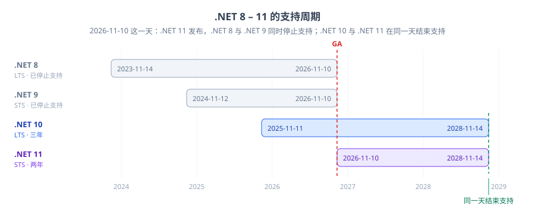

### 前言

[.NET 11](https://devblogs.microsoft.com/dotnet/announcing-dotnet-11/?wt.mc_id=MVP_324329) 于 2026 年 11 月 10 日随 .NET Conf 2026 正式发布，SDK 版本为 11.0.100。这是一个 **STS（标准期限支持）** 版本。

同一天，**.NET 8 和 .NET 9 停止支持**。不论是否打算用 .NET 11 的新特性，还停留在这两个版本上的项目都已经收不到安全补丁了。

8 月份写过两篇 Preview 7 的文章，GA 版本与之相比的变化会在下文对应位置注明：

- [.NET 11 Preview 7：CLI、构建、测试与 Blazor 更新](/2026/08/21/dotnet11-preview7-build-and-cost/)
- [.NET 11 Preview 7 中的 C# 15 与 runtime-async 更新](/2026/08/28/dotnet11-preview7-csharp15-and-runtime-async/)

几个重点方向另有专文：

- [C# 15 联合类型与封闭层次实战](/2026/11/11/csharp15-union-and-closed/)
- [.NET 11 基础库：值得马上用起来的新 API](/2026/11/12/dotnet11-libraries/)
- [EF Core 11 新特性：更精简的 SQL 与 FullJoin](/2026/11/12/efcore11-whats-new/)

### 1. 先决定升不升：支持周期



| 版本 | 类型 | 发布 | 结束支持 |
|---|---|---|---|
| .NET 8 | LTS | 2023-11-14 | **2026-11-10（已结束）** |
| .NET 9 | STS | 2024-11-12 | **2026-11-10（已结束）** |
| .NET 10 | LTS | 2025-11-11 | 2028-11-14 |
| .NET 11 | STS | 2026-11-10 | 2028-11-14 |

STS 的支持期从 18 个月延长到 24 个月以后，出现了一个有意思的结果：**.NET 10 和 .NET 11 在同一天结束支持**。选择 LTS 还是 STS 已经不影响支持时长，两者都要在 2028 年 11 月前迁移到 .NET 12（LTS，预计 2027 年 11 月发布）。

所以这次的选择只看两点：

- 是否需要 .NET 11 的新能力，例如 C# 15 的 union、EF Core 11（它只支持 .NET 11）。
- 团队是否愿意多做一次大版本升级。这几年 .NET 大版本之间的升级成本已经很低，主要成本在于回归测试。

还在 .NET 8 的项目，可以直接跳到 .NET 11，不必先经过 10。

### 2. C# 15

C# 15 是 `net11.0` 项目的默认语言版本。除内存安全外，以下特性都不再需要 `LangVersion=preview`：

| 特性 | 一句话 |
|---|---|
| 联合类型 `union` | 值是一组案例类型之一，`switch` 不需要兜底分支 |
| 封闭层次 `closed` | 只能在本程序集内派生，`switch` 可以做穷尽性检查 |
| 集合表达式参数 | `[with(capacity: n), ..items]` |
| 扩展索引器 | `extension` 块里可以声明索引器 |
| 带标签的 `break`/`continue` | 直接跳出或继续外层循环 |
| 旧运行时上的非虚静态接口成员 | 面向 `netstandard2.0` 的库也能在接口里放静态辅助方法 |
| 内存安全（预览） | `unsafe` 的范围收窄到真正访问内存的操作 |

前两项是本次的重点，System.Text.Json、Minimal API、SignalR、OpenAPI 都同步做了支持，用法与选型见 [C# 15 联合类型与封闭层次实战](/2026/11/11/csharp15-union-and-closed/)。

### 3. 运行时

#### 3.1 Runtime Async：可以试用，但默认不开

Runtime Async 把 `async`/`await` 的挂起和恢复从编译器生成的状态机移交给运行时。GA 版本的实际状态：

- **框架自身的库**已经按 Runtime Async 编译，升级到 .NET 11 后自动受益。
- **你自己的代码**默认仍然编译成状态机。要开启，需要在项目文件中加入：

```xml
<PropertyGroup>
  <Features>$(Features);runtime-async=on</Features>
</PropertyGroup>
```

不需要再加 `EnablePreviewFeatures`。可以用反射确认它是否生效：

```csharp
var m = typeof(Demo).GetMethod(nameof(Demo.B))!;
Console.WriteLine($"AsyncStateMachine={m.GetCustomAttribute<AsyncStateMachineAttribute>() != null}, ImplFlags={m.MethodImplementationFlags}");

static class Demo { public static async Task B() { await Task.Yield(); } }
```

```text
默认：                 AsyncStateMachine=True,  ImplFlags=IL
runtime-async=on 后：  AsyncStateMachine=False, ImplFlags=Async
```

发布公告仍把这项功能标为预览，用户代码默认开启要等到之后的版本。可以先在非关键服务上打开，观察分配和延迟的变化。分层编译、`Task`/`ValueTask` 工厂方法内建识别等实现细节，见 [Preview 7 那篇](/2026/08/28/dotnet11-preview7-csharp15-and-runtime-async/)。

#### 3.2 最低硬件要求提高（破坏性变更）

x86/x64 的最低指令集从 `x86-64-v1` 提高到 **`x86-64-v2`**（要求 SSE4.2、POPCNT 等）。在不支持的 CPU 上，进程会直接报 “The current CPU is missing one or more of the baseline instruction sets” 并退出。Windows 11 本身就要求这一级别，2013 年以后的 Intel/AMD 处理器都满足；真正需要排查的是老旧的虚拟化宿主机，以及显式屏蔽了 CPU 特性的虚拟机配置。

ReadyToRun 镜像在 Windows/Linux x64 上改为面向 `x86-64-v3`（AVX2），低于此级别的机器能运行，但部分代码会回退到 JIT，启动稍慢。Arm64 的最低要求不变。

#### 3.3 其他

- JIT：更多的边界检查消除、去虚化、`switch` 表达式折叠，`SequenceEqual` 常量折叠；x64 上的 `Math.BigMul` 只生成一条 `MUL` 指令。
- NativeAOT：接口调用改用共享分派辅助函数，调用点更小，接口密集型代码吞吐更高。
- `Half` 在支持的 x64/Arm64 硬件上使用 FP16 指令；向量类型新增 `CreateGeometricSequence`、`Zip`、`Unzip`、`Concat` 系列 API。
- 进程内崩溃报告扩展到 Linux 和 macOS，进程退出前会记录托管堆栈。
- 浮点数转换为小整数类型（`byte`、`short` 等）改为饱和转换，属于行为变化。

### 4. 基础库

最实用的几项，详见 [.NET 11 基础库：值得马上用起来的新 API](/2026/11/12/dotnet11-libraries/)：

- `Process.RunAndCaptureText`：一行运行外部命令并拿到输出，避免手写重定向时的死锁陷阱。
- `ZstandardStream` 加入 `System.IO.Compression`。
- `StringStream`、`ReadOnlyMemoryStream` 等不复制数据的 `Stream` 包装。
- LINQ `FullJoin`，以及不需要结果选择器、直接返回元组的 `Join`/`LeftJoin`/`RightJoin`。
- `EqualityComparer<T>.Create(keySelector)`。
- DataAnnotations 异步校验：`AsyncValidationAttribute`、`Validator.ValidateObjectAsync`。
- System.Text.Json 支持 C# union 和 F# 可区分联合，可以输出 JSON Lines。

### 5. SDK 与工具

Preview 7 那篇已经介绍过的 **NativeAOT 版 CLI**、**MSBuild Server 默认开启**、`dotnet test` 的运行级选项、容器发布优先使用平台原生运行时，GA 版本都保持不变。此外还有：

**文件级应用支持多文件。** `#:include` 可以引用同目录的其他 `.cs` 文件，`dotnet run -e` 可以从命令行传入环境变量：

```csharp
// app.cs
#:include helpers.cs
Console.WriteLine($"{Greeting.Text} {Environment.GetEnvironmentVariable("STAGE")}");

// helpers.cs
static class Greeting { public const string Text = "hello from helpers.cs,"; }
```

```text
> dotnet run app.cs -e STAGE=prod
warning CA2266: File-based program entry point should start with '#!'
hello from helpers.cs, prod
```

新增的 CA2266 规则建议文件级应用以 shebang 行开头，在第一行加上 `#!/usr/bin/env dotnet` 即可消除。

其他变化：

- `dotnet sln` 可以创建、编辑解决方案筛选器 `.slnf`。
- `dotnet watch` 集成 Aspire AppHost，进程崩溃后会自动恢复，MAUI 项目可以选择目标设备。
- 测试模板支持 xUnit v3（默认使用 Microsoft.Testing.Platform）和 NUnit，`dotnet test` 可以运行 Android/iOS/Mac Catalyst 测试项目。
- `dotnet nuget add source --min-publish-age-hours 72`：只接受发布超过指定时长的包，可以防御“抢注后立即投毒”式的供应链攻击。不过它只是一层延迟，不能替代漏洞扫描。
- 容器镜像可以通过 `SOURCE_DATE_EPOCH` 得到可复现的摘要，目标仓库已有的层不再重复上传。
- Linux/macOS 安装包通过程序集去重缩小了体积。
- CLI 遥测从 Application Insights 改为 OpenTelemetry。

**dotnetup**（公开预览）是新的 SDK/运行时安装管理工具，装在用户目录下，支持多版本并存，不需要管理员权限。

### 6. ASP.NET Core 11

#### 6.1 Web API

**OpenAPI 默认生成 3.2 版本**（破坏性变更）。如果下游工具还不认识 3.2，可以降回 3.1：

```csharp
builder.Services.AddOpenApi(o => o.OpenApiVersion = OpenApiSpecVersion.OpenApi3_1);
```

`Microsoft.OpenApi` 同时升级到 3.x，自定义过文档转换器的项目需要按新 API 调整。3.2 版本能描述 `TypedResults.ServerSentEvents` 中每个事件的数据结构，以及 HTTP `QUERY` 方法；标了 `[Obsolete]` 的接口会输出为 `deprecated: true`。

**`[ShortCircuit]` 特性**：命中该端点后跳过后续中间件，适合健康检查这类不需要认证、日志、压缩的端点：

```csharp
app.MapGet("/health", [ShortCircuit] () => "ok");
```

其他：

- 参数绑定失败时，端点过滤器也会执行，可以在过滤器里统一改写 400 响应。
- 校验支持异步规则，并内置本地化（`ValidationOptions.LocalizerProvider`）。
- 默认启用 Zstandard 响应压缩和请求解压。
- HTTP/3 不再等待对方的 SETTINGS 帧就开始处理请求，首个请求的延迟更低。
- 托管层原生输出符合 OpenTelemetry 语义约定的 HTTP 标签，不需要额外的 instrumentation 库。
- 新增 `IOutputCachePolicyProvider`，可以按租户或配置动态决定输出缓存策略。

#### 6.2 SignalR

**刷新身份令牌不再需要断开连接。** 以前 Bearer Token 过期后只能断线重连；现在服务端开启 `EnableAuthenticationRefresh`，.NET 客户端用 `WithAuthenticationRefresh` 就能在连接上直接换新令牌，TypeScript 客户端也有对应的 API。客户端还可以通过 `InvokeAsync(..., cancellationToken)` 取消非流式的 Hub 调用。

#### 6.3 Blazor

- 静态 SSR 下可以使用 `TempData` 和 Session（`[SupplyParameterFromTempData]`、`[SupplyParameterFromSession]`），“提交后显示提示消息”这类场景不必为此开启交互模式。
- 静态 SSR 表单默认启用**客户端校验**，不再每次都回服务器。
- `Virtualize` 支持高度不一的项，新增 `AnchorMode`、`ScrollToItemAsync`；`QuickGrid` 的分页和排序状态写进 URL，可以直接分享链接。
- 服务端可以主动请求暂停电路（`RequestCircuitPauseAsync`），适合在部署前让客户端平滑断开。
- 实验性的 `Microsoft.AspNetCore.Components.AI` 提供流式聊天、工具调用渲染、审批流程等组件，整个 .NET 11 周期都会保持预览状态。

Preview 7 那篇介绍的两项在 GA 版中保持原样：`CacheView` 是内置组件，直接使用即可；隐藏标签页时自动暂停电路仍需安装 `Microsoft.AspNetCore.Components.Server.AutoPause` 包并调用 `AddAutoPause`。

#### 6.4 破坏性变更摘录

- `ConcurrencyLimiter` 中间件已移除，改用 `Microsoft.AspNetCore.RateLimiting`。
- Blazor SSR 的防伪校验交给中间件处理，多数项目不需要再手动调用 `app.UseAntiforgery()`。
- Kestrel 更严格地遵守 HTTP 协议规范，以前能容忍的不规范请求现在可能被拒绝。
- 响应压缩始终输出 `Vary: Accept-Encoding`。
- SqlClient 的 Active Directory 认证移到了单独的包中。

完整清单见 [Breaking changes in ASP.NET Core 11](https://learn.microsoft.com/aspnet/core/breaking-changes/11/overview?wt.mc_id=MVP_324329)。

### 7. EF Core 11

EF Core 11 只能运行在 .NET 11 上。升级后，`Include` 引用导航时多余的 JOIN 和 ORDER BY 会被自动去掉；LINQ `FullJoin` 翻译为 `FULL JOIN`；复杂类型可以建索引、支持 TPT/TPC 继承；可以保留关系但不生成外键约束；SQL Server 的默认兼容级别升到 160。

新旧 SQL 的对比见 [EF Core 11 新特性：更精简的 SQL 与 FullJoin](/2026/11/12/efcore11-whats-new/)。

### 8. AI：SDK 自带 MCP 服务器模板

```bash
dotnet new mcpserver -n McpDemo
```

生成的项目引用了官方 MCP C# SDK（`ModelContextProtocol` 2.1.0），使用 stdio 传输，并附带一个示例工具：

```csharp
builder.Services
    .AddMcpServer()
    .WithStdioServerTransport()
    .WithTools<RandomNumberTools>();

internal class RandomNumberTools
{
    [McpServerTool]
    [Description("Generates a random number between the specified minimum and maximum values.")]
    public int GetRandomNumber(
        [Description("Minimum value (inclusive)")] int min = 0,
        [Description("Maximum value (exclusive)")] int max = 100)
        => Random.Shared.Next(min, max);
}
```

项目文件里设置了 `PackAsTool` 和 `PackageType=McpServer`，打包成 NuGet 工具后，MCP 客户端可以直接通过 `dnx` 拉取运行。所有日志都写到标准错误，因为标准输出要留给 MCP 协议消息。MCP 的基本概念见 [.NET 开发者必读的 MCP 协议实战指南](/2025/06/13/what-is-mcp/)。

AI 相关的其他组件：

- **Microsoft.Extensions.AI**：`IChatClient`、`IEmbeddingGenerator` 等抽象，可以接入依赖注入、缓存和 OpenTelemetry。
- **Microsoft Agent Framework**：构建能调用工具、保留会话状态的智能体，以及编排多个智能体的工作流；可以通过 AG-UI 端点暴露给前端。
- **.NET Skills**：给编码智能体提供 .NET 专属的指导；**.NET Upgrade canvas** 可以可视化地展示 GitHub Copilot 升级会话的评估结果和进度。

### 9. MAUI 与 Windows 桌面

- .NET MAUI 在移动端**默认改用 CoreCLR**，替代 Mono。Android 的最低 API 级别提高到 24，不再支持 Android x86；`Microsoft.Maui.Controls.Compatibility` 不再发布。XAML 增量热重载（预览）在 Debug 构建中默认开启。
- Windows Forms 新增可选的现代视觉样式，能跟随系统的视觉和辅助功能设置。
- WPF 以可靠性修复为主。

### 10. 升级清单

1. 安装 SDK 11.0.100。如果仓库有 `global.json`，同步修改版本号；只装 SDK 不会自动改变项目的目标框架。
2. 把 `TargetFramework` 改为 `net11.0`（保留 `-windows`、`-android` 等平台后缀），同时升级 `Microsoft.*` 包和工作负载。
3. 对照 [Breaking changes in .NET 11](https://learn.microsoft.com/dotnet/core/compatibility/11?wt.mc_id=MVP_324329) 排查，重点关注：
   - CPU 最低要求 `x86-64-v2`，检查老旧的 CI 代理和虚拟机。
   - NativeAOT CLI 与 MSBuild Server 默认开启，CI 中依赖“每次构建都是全新进程”的脚本要复查。
   - OpenAPI 默认 3.2、`ConcurrencyLimiter` 移除、Kestrel 协议校验收紧。
   - `IHost.RunAsync` 在 `BackgroundService` 失败时抛出异常；配置链中的空字符串会覆盖前面提供程序的值。
   - EF Core：SQL Server 默认兼容级别 160；Cosmos DB 不再保留未映射字段。
4. 用与生产相同的发布方式（框架依赖 / 自包含 / NativeAOT / 容器镜像）跑一遍回归测试和性能对比。
5. 还在 RC 版本的项目，换成正式版的 SDK、运行时和包版本。

参考：[Announcing .NET 11](https://devblogs.microsoft.com/dotnet/announcing-dotnet-11/?wt.mc_id=MVP_324329)、[What's new in .NET 11](https://learn.microsoft.com/dotnet/core/whats-new/dotnet-11/overview?wt.mc_id=MVP_324329)、[What's new in ASP.NET Core 11](https://learn.microsoft.com/aspnet/core/release-notes/aspnetcore-11?wt.mc_id=MVP_324329)、[.NET 支持策略](https://dotnet.microsoft.com/platform/support/policy/dotnet-core?wt.mc_id=MVP_324329)。
