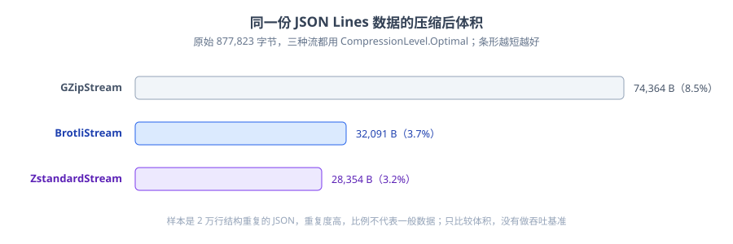

### 前言

.NET 11 基础库的更新条目很长，从 IEEE 754 十进制浮点类型到 ML-KEM 后量子加密都有。下面挑出日常业务代码里最容易用上的几项，每一项都给出旧写法与新写法的对照。示例在 .NET SDK 11.0.100 上运行，输出为实际结果。

### 1. Process：一行代码运行并拿到输出

调用外部命令并读取输出，是 `Process` 最常见的用法，也是最容易写错的地方。下面这种写法看起来没有问题：

```csharp
process.Start();
process.WaitForExit();
string output = process.StandardOutput.ReadToEnd();
string error = process.StandardError.ReadToEnd();
```

但当子进程输出超过管道缓冲区时，子进程阻塞在写入上，父进程阻塞在 `WaitForExit` 上，两边互相等待，形成死锁。正确的写法需要同时排空两个流：

```csharp
process.Start();
Task<string> outputTask = process.StandardOutput.ReadToEndAsync();
Task<string> errorTask = process.StandardError.ReadToEndAsync();
await Task.WhenAll(outputTask, errorTask, process.WaitForExitAsync());
string output = await outputTask;
string error = await errorTask;
```

.NET 11 把这套模式收进了框架：

```csharp
ProcessTextOutput result = Process.RunAndCaptureText("dotnet", ["--version"]);
Console.WriteLine($"exit={result.ExitStatus.ExitCode}, stdout={result.StandardOutput.Trim()}");

ProcessTextOutput failed = Process.RunAndCaptureText("dotnet", ["no-such-command"]);
Console.WriteLine($"exit={failed.ExitStatus.ExitCode}, stderr 行数={failed.StandardError.Split('\n', StringSplitOptions.RemoveEmptyEntries).Length}");
```

```text
exit=0, stdout=11.0.100
exit=1, stderr 行数=1
```

只关心退出状态时用 `Process.Run`，它同样接受超时参数，超时后会结束子进程：

```csharp
ProcessExitStatus timedOut = Process.Run(
    new ProcessStartInfo("powershell", ["-NoProfile", "-Command", "Start-Sleep 10"]),
    timeout: TimeSpan.FromSeconds(1));
Console.WriteLine($"canceled={timedOut.Canceled}"); // canceled=True
```

需要边运行边处理输出时，`ReadAllLinesAsync` 会把标准输出和标准错误按到达顺序合并成一个序列，每行都标明来源：

```csharp
using Process p = Process.Start(new ProcessStartInfo("dotnet", ["--list-sdks"])
{
    RedirectStandardOutput = true,
    RedirectStandardError = true,
})!;

await foreach (ProcessOutputLine line in p.ReadAllLinesAsync())
    Console.WriteLine($"{(line.StandardError ? "ERR" : "OUT")} {line.Content}");
```

同一批更新还有：

- `Process.StartAndForget(...)`：启动后立即释放所有资源，只返回进程 ID。
- `SafeProcessHandle.WaitForExitOrKillOnTimeout(...)`：等待退出，超时则强制结束。
- `ProcessStartInfo.KillOnParentExit`：父进程退出时连带结束子进程（Windows、Linux、Android）。
- `ProcessStartInfo.InheritedHandles`：精确控制子进程继承哪些句柄；默认的“继承全部可继承句柄”经常导致文件或套接字被意外占用。
- `ProcessExitStatus.Signal`：在 Unix 上可以知道进程是被哪个信号结束的。

### 2. Zstandard 进入 System.IO.Compression

`ZstandardStream` 与 `GZipStream`、`BrotliStream` 用法一致，换掉类名即可：

```csharp
Report("GZip", s => new GZipStream(s, CompressionLevel.Optimal, leaveOpen: true));
Report("Brotli", s => new BrotliStream(s, CompressionLevel.Optimal, leaveOpen: true));
Report("Zstandard", s => new ZstandardStream(s, CompressionLevel.Optimal, leaveOpen: true));

void Report(string name, Func<Stream, Stream> factory)
{
    using var ms = new MemoryStream();
    using (var z = factory(ms)) z.Write(payload);
    Console.WriteLine($"{name,-10}{ms.Length,10:N0} 字节");
}
```

`payload` 是 2 万行结构重复的 JSON Lines，原始大小 877,823 字节：



这份数据重复度很高，三者的绝对比例不能外推到一般数据，只能看出相对位置：Zstandard 在 Optimal 级别下比 Brotli 略小，两者都远小于 GZip。Zstandard 的主要优势在于压缩和解压速度，体积不是重点，这里没有做吞吐基准，不展开比较速度。

ASP.NET Core 11 的响应压缩和请求解压中间件也已默认加入 zstd 提供程序，客户端带 `Accept-Encoding: zstd` 时就会用上。

同一领域有两个行为变化要留意：读取 ZIP 条目时会**校验 CRC32**，以前能“读出来”的损坏文件现在会抛异常；`DeflateStream`/`GZipStream` 对空数据也会写出头和尾。

### 3. 不复制数据的 Stream 包装

以前把字符串或已有缓冲区交给只接受 `Stream` 的 API，通常要先复制一份：

```csharp
using var s1 = new MemoryStream(Encoding.UTF8.GetBytes(yaml));    // 多一次编码和分配
using var s2 = new MemoryStream(buffer.ToArray());                 // ReadOnlyMemory<byte> 复制成数组
```

.NET 11 新增了四个包装类型：

```csharp
using (var reader = new StreamReader(new StringStream(yaml, Encoding.UTF8)))
    Console.WriteLine(reader.ReadLine());              // name: demo

ReadOnlyMemory<byte> buffer = "hello"u8.ToArray();
using (var ros = new ReadOnlyMemoryStream(buffer))
    Console.WriteLine($"Length={ros.Length}, CanWrite={ros.CanWrite}"); // Length=5, CanWrite=False
```

| 类型 | 包装的对象 |
|---|---|
| `StringStream` | `string` 或 `ReadOnlyMemory<char>`，按指定编码边读边编码 |
| `ReadOnlyMemoryStream` | `ReadOnlyMemory<byte>`，只读 |
| `WritableMemoryStream` | `Memory<byte>`，可写但长度固定 |
| `ReadOnlySequenceStream` | `ReadOnlySequence<byte>`，不需要先拼成连续内存 |

### 4. LINQ：FullJoin 和返回元组的 Join

全外连接以前要拼两段查询：

```csharp
var left = employees.GroupJoin(depts, e => e.DeptId, d => d.Id, (e, ds) => (e, ds))
    .SelectMany(x => x.ds.DefaultIfEmpty(), (x, d) => (x.e, d));
var rightOnly = depts.Where(d => !employees.Any(e => e.DeptId == d.Id))
    .Select(d => (e: default((string, int)), d));
var full = left.Concat(rightOnly);
```

.NET 10 已经补上了 `LeftJoin`/`RightJoin`，.NET 11 补齐了 `FullJoin`，而且三者都可以省略结果选择器，直接返回元组：

```csharp
var employees = new[] { (Name: "张三", DeptId: 1), (Name: "李四", DeptId: 2), (Name: "王五", DeptId: 9) };
var depts = new[] { (Id: 1, Title: "研发"), (Id: 2, Title: "市场"), (Id: 3, Title: "财务") };

foreach (var (e, d) in employees.FullJoin(depts, e => e.DeptId, d => d.Id))
    Console.WriteLine($"{e.Name ?? "(无人)",-6}{d.Title ?? "(无部门)"}");
```

```text
张三    研发
李四    市场
王五    (无部门)
(无人)  财务
```

没有匹配的一侧取 `default`。普通的 `Join`、`GroupJoin` 也新增了不带结果选择器的重载：

```csharp
foreach (var (e, d) in employees.Join(depts, e => e.DeptId, d => d.Id))
    Console.WriteLine($"{e.Name} -> {d.Title}");
```

这些运算符在 `Queryable` 与 `AsyncEnumerable` 上同样可用，EF Core 11 会把 `FullJoin` 翻译成 SQL 的 `FULL JOIN`，详见 [EF Core 11 新特性：更精简的 SQL 与 FullJoin](/2026/11/12/efcore11-whats-new/)。

### 5. EqualityComparer.Create：按键比较不用再写类

按某个属性去重，以前要实现一个 `IEqualityComparer<T>`：

```csharp
sealed class UserByEmailComparer : IEqualityComparer<User>
{
    public bool Equals(User? x, User? y) =>
        string.Equals(x?.Email, y?.Email, StringComparison.OrdinalIgnoreCase);
    public int GetHashCode(User obj) =>
        StringComparer.OrdinalIgnoreCase.GetHashCode(obj.Email);
}
```

现在一行即可，还能为键指定比较器：

```csharp
var byEmail = EqualityComparer<User>.Create(u => u?.Email, StringComparer.OrdinalIgnoreCase);
var users = new HashSet<User>(byEmail)
{
    new("a@x.com", "Alice"),
    new("A@X.COM", "Alice 2"),
    new("b@x.com", "Bob"),
};
Console.WriteLine(users.Count); // 2
```

键选择器的参数类型是可空的，写成 `u => u.Email` 会得到 CS8602 警告，用 `u?.Email` 即可消除。

### 6. DataAnnotations 异步校验

“用户名是否已被占用”这类规则需要查询数据库。以前的 `ValidationAttribute` 只有同步的 `IsValid`，要么在里面 `.GetAwaiter().GetResult()` 阻塞线程，要么把校验挪到服务层，与其他特性校验分成两处。

.NET 11 新增了 `AsyncValidationAttribute`：

```csharp
class SignUp
{
    [Required, UniqueUserName]
    public string UserName { get; set; } = "";
}

sealed class UniqueUserNameAttribute : AsyncValidationAttribute
{
    static readonly HashSet<string> Taken = ["admin", "root"];

    protected override ValidationResult? IsValid(object? value, ValidationContext context) =>
        throw new InvalidOperationException("请使用异步校验。");

    protected override async Task<ValidationResult?> IsValidAsync(
        object? value, ValidationContext context, CancellationToken cancellationToken)
    {
        await Task.Delay(10, cancellationToken); // 模拟查询数据库
        return value is string name && Taken.Contains(name)
            ? new ValidationResult($"用户名 {name} 已被占用", [context.MemberName!])
            : ValidationResult.Success;
    }
}

var model = new SignUp { UserName = "admin" };
var results = new List<ValidationResult>();
bool ok = await Validator.TryValidateObjectAsync(model, new ValidationContext(model), results, validateAllProperties: true);
Console.WriteLine($"ok={ok}: {string.Join("; ", results.Select(r => r.ErrorMessage))}");
// ok=False: 用户名 admin 已被占用
```

同步的 `IsValid` 仍然必须重写，抛异常可以防止有人误用同步的 `Validator.ValidateObject` 而悄悄跳过这条规则。除了特性，还可以实现 `IAsyncValidatableObject` 做跨属性的异步校验。ASP.NET Core 11 的 Minimal API（`AddValidation()`）和 Blazor 表单都会执行这些异步规则；`Microsoft.Extensions.Options` 也新增了 `IAsyncStartupValidator`，原来的 `IStartupValidator` 已标记为过时。

### 7. System.Text.Json 输出 JSON Lines

日志导出、批量数据交换常用 JSONL（每行一个 JSON 值）。`SerializeAsyncEnumerable` 新增 `topLevelValues` 参数，可以直接把异步序列写成 JSONL，不必手工逐条序列化再拼换行：

```csharp
using var jsonl = new MemoryStream();
await JsonSerializer.SerializeAsyncEnumerable(jsonl, ReadEvents(), topLevelValues: true);
Console.Write(Encoding.UTF8.GetString(jsonl.ToArray()));

static async IAsyncEnumerable<AuditEvent> ReadEvents()
{
    for (int i = 1; i <= 3; i++)
    {
        await Task.Delay(1);
        yield return new AuditEvent(i, $"step-{i}");
    }
}

record AuditEvent(int Id, string Action);
```

```text
{"Id":1,"Action":"step-1"}
{"Id":2,"Action":"step-2"}
{"Id":3,"Action":"step-3"}
```

JSONL 模式下会忽略 `WriteIndented`，换行固定为 LF。System.Text.Json 在 .NET 11 的另一项大更新是支持 C# union，见 [C# 15 联合类型与封闭层次实战](/2026/11/11/csharp15-union-and-closed/)。

### 8. 其他值得留意的 API

- `Random.NextInteger<T>()`、`NextBinaryFloat<T>()`：泛型随机数，`byte`、`long`、`Half` 都能直接生成。
- `Decimal32`/`Decimal64`/`Decimal128`：IEEE 754 十进制浮点，适合与使用同一标准的数据库、金融协议交互；它们不是 `decimal` 的替代品。
- `DnsResolver`：按记录类型返回强类型的 DNS 解析结果，不再局限于 `Dns.GetHostAddresses` 这类地址解析，Windows、Linux、macOS 均可用。
- `X25519DiffieHellman`、AES 无填充密钥包装（`EncryptKeyWrap`/`DecryptKeyWrap`）。
- `BitArray` 新增接受 `ReadOnlySpan<...>` 的构造函数和 `PopCount()`。
- 控制台支持 `FORCE_COLOR` 环境变量：输出被重定向（例如 `dotnet run | tee build.log`）时也保留颜色。
- 在 `Microsoft.Extensions.Diagnostics` 中可以通过规则配置要采集哪些 `Activity`，不再需要手写 `ActivityListener`。

升级时还有几项基础库的行为变化需要回归：`Math.Round` 返回正确舍入的结果，`DateOnly`/`TimeOnly` 的 `TryParse` 对非法参数抛出异常，Unix 上的命名互斥体默认改为用户级作用域。完整清单见 [Breaking changes in .NET 11](https://learn.microsoft.com/dotnet/core/compatibility/11?wt.mc_id=MVP_324329)。

参考：[What's new in .NET 11 libraries](https://learn.microsoft.com/dotnet/core/whats-new/dotnet-11/libraries?wt.mc_id=MVP_324329)、[Process API improvements in .NET 11](https://devblogs.microsoft.com/dotnet/process-api-improvements-in-dotnet-11/?wt.mc_id=MVP_324329)。
