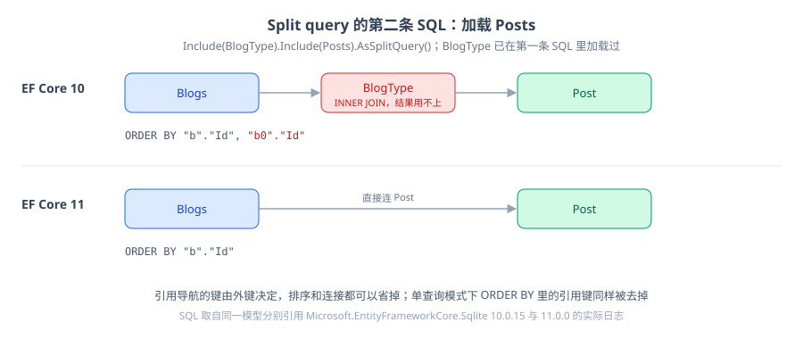

### 前言

[EF Core 11](https://learn.microsoft.com/ef/core/what-is-new/ef-core-11.0/whatsnew?wt.mc_id=MVP_324329) 与 .NET 11 同时发布，并且**只能运行在 .NET 11 上**，不支持 .NET 10，也不支持 .NET Framework。升级 EF Core 11 也就意味着项目要升级到 .NET 11。

下面的 SQL 都不是手写的，而是同一份模型和查询分别引用 `Microsoft.EntityFrameworkCore.Sqlite` **10.0.15** 和 **11.0.0**，在 SQLite 内存库上执行时记录的实际日志。示例模型如下：

```csharp
public class Blog
{
    public int Id { get; set; }
    public string Name { get; set; } = "";
    public int BlogTypeId { get; set; }
    public BlogType BlogType { get; set; } = null!;
    public int OwnerId { get; set; }
    public Person Owner { get; set; } = null!;
    public List<Post> Posts { get; set; } = [];
    public BlogDetails Details { get; set; } = new();   // 复杂类型
}

public class BlogDetails
{
    public string Description { get; set; } = "";
    public string Language { get; set; } = "zh-CN";
}

public class Customer { public int Id { get; set; } public string Name { get; set; } = ""; }
public class Order { public int Id { get; set; } public int? CustomerId { get; set; } public decimal Total { get; set; } }
```

SQL 通过 `LogTo` 只捕获 `CommandExecuted` 事件：

```csharp
protected override void OnConfiguring(DbContextOptionsBuilder b) => b
    .UseSqlite("Data Source=:memory:")
    .LogTo(log, [RelationalEventId.CommandExecuted]);
```

### 1. 引用导航不再产生多余的 JOIN 和排序

查询同时 `Include` 一个引用导航和一个集合导航，并使用拆分查询：

```csharp
var blogs = await db.Blogs
    .Include(b => b.BlogType)
    .Include(b => b.Posts)
    .AsSplitQuery()
    .ToListAsync();
```

第二条 SQL 负责加载 `Posts`。EF Core 10：

```sql
SELECT "p"."Id", "p"."BlogId", "p"."Title", "b"."Id", "b0"."Id"
FROM "Blogs" AS "b"
INNER JOIN "BlogType" AS "b0" ON "b"."BlogTypeId" = "b0"."Id"
INNER JOIN "Post" AS "p" ON "b"."Id" = "p"."BlogId"
ORDER BY "b"."Id", "b0"."Id"
```

EF Core 11：

```sql
SELECT "p"."Id", "p"."BlogId", "p"."Title", "b"."Id"
FROM "Blogs" AS "b"
INNER JOIN "Post" AS "p" ON "b"."Id" = "p"."BlogId"
ORDER BY "b"."Id"
```



`BlogType` 已经在第一条 SQL 里加载过，第二条 SQL 只需要 `Blogs` 的主键来关联 `Posts`，那次 `INNER JOIN` 纯属浪费。第一条 SQL 的 `ORDER BY` 也从 `"b"."Id", "b0"."Id"` 变成了 `"b"."Id"`。

不拆分查询时，引用导航的键同样从 `ORDER BY` 中去掉了：

```csharp
var blogs = await db.Blogs.Include(b => b.Owner).Include(b => b.Posts).ToListAsync();
```

```sql
-- EF Core 10
ORDER BY "b"."Id", "p"."Id"
-- EF Core 11
ORDER BY "b"."Id"
```

道理相同：`Owner` 由 `Blogs` 上的外键唯一确定，`b.Id` 已经足以保证结果分组。EF 团队在 SQL Server 上的测试中，拆分查询场景提升约 29%，单查询场景提升约 22%。实际收益取决于引用导航的数量和表的大小，不需要改任何代码，升级后就能生效。

### 2. FullJoin 翻译为 FULL JOIN

.NET 11 给 LINQ 增加了 `FullJoin`（见 [.NET 11 基础库：值得马上用起来的新 API](/2026/11/12/dotnet11-libraries/)），EF Core 11 会把它翻译成 SQL 的 `FULL JOIN`：

```csharp
var rows = await db.Customers
    .FullJoin(db.Orders,
        c => c.Id,
        o => o.CustomerId,
        (c, o) => new
        {
            Customer = c == null ? null : c.Name,
            OrderId = o == null ? (int?)null : o.Id,
        })
    .ToListAsync();
```

```sql
SELECT "c"."Name" AS "Customer", "o"."Id" AS "OrderId"
FROM "Customers" AS "c"
FULL JOIN "Orders" AS "o" ON "c"."Id" = "o"."CustomerId"
```

```text
张三 / 1
李四 / (无订单)
(无客户) / 2
```

以前在 EF Core 中实现全外连接，只能写原始 SQL，或者用左连接加右侧反连接再 `Concat`。注意 SQLite 从 3.39 起才支持 `FULL JOIN`；MySQL 不支持 `FULL JOIN`，对应的提供程序是否翻译要看具体实现。

结果里的 `(无客户) / 2` 是一张引用了不存在客户的订单，它是怎么写进数据库的，见第 5 节。

### 3. MaxBy / MinBy

“取帖子最多的博客”以前要写成 `OrderByDescending(...).FirstOrDefaultAsync()`，现在可以直接表达意图：

```csharp
var top = await db.Blogs.MaxByAsync(b => b.Posts.Count());
```

```sql
SELECT "b"."Id", "b"."BlogTypeId", "b"."Name", "b"."OwnerId", "b"."Details_Description", "b"."Details_Language"
FROM "Blogs" AS "b"
ORDER BY (
    SELECT COUNT(*)
    FROM "Post" AS "p"
    WHERE "b"."Id" = "p"."BlogId") DESC
LIMIT 1
```

生成的 SQL 与手写 `OrderByDescending` 相同，区别只在可读性。

### 4. 复杂类型：配置更顺手，可以建键和索引

EF Core 10 中，配置复杂类型里的属性要先拿到复杂类型的构建器：

```csharp
mb.Entity<Blog>().ComplexProperty(b => b.Details)
    .Property(d => d.Description).HasMaxLength(500);
```

EF Core 11 可以在 lambda 里直接用成员链，也可以在复杂类型的属性上建索引：

```csharp
mb.Entity<Blog>().ComplexProperty(b => b.Details);
mb.Entity<Blog>().Property(b => b.Details.Description).HasMaxLength(500);
mb.Entity<Blog>().HasIndex(b => b.Details.Language);
```

`GenerateCreateScript()` 的输出中多了这一行：

```sql
CREATE INDEX "IX_Blogs_Details_Language" ON "Blogs" ("Details_Language");
```

主键同样可以指向复杂类型里的标量属性，例如强类型 ID：`HasKey(c => c.CustomerId.Value)`。映射为 JSON 列的复杂集合可以用字符串路径建索引，如 `HasIndex("Items[].Sku")`。

另外两项补齐了长期以来的限制：

- 复杂类型和 JSON 列现在可以用在 **TPT/TPC 继承**的实体上。
- **Azure Cosmos DB** 提供程序完整支持复杂类型，嵌入为文档内的嵌套对象或数组。

EF 团队这个版本修了一批复杂类型的缺陷，目的是让它能够替代 owned entity。还在用 owned entity 映射值对象的项目，可以评估迁移到复杂类型。

### 5. 保留关系，但不在数据库里建外键

对接老库、做数据同步时，常常需要在模型里保留导航和关系，但数据库中不能有外键约束，比如同步顺序无法保证先写主表。以前只能在每个迁移里手工删掉 `AddForeignKey`。

EF Core 11 提供了 `ExcludeForeignKeyFromMigrations()`：

```csharp
mb.Entity<Order>()
    .HasOne<Customer>()
    .WithMany()
    .HasForeignKey(o => o.CustomerId)
    .ExcludeForeignKeyFromMigrations();
```

建表脚本对比：

```sql
-- EF Core 10（未排除）
CONSTRAINT "FK_Orders_Customers_CustomerId" FOREIGN KEY ("CustomerId") REFERENCES "Customers" ("Id")
CREATE INDEX "IX_Orders_CustomerId" ON "Orders" ("CustomerId");

-- EF Core 11（已排除）
CREATE INDEX "IX_Orders_CustomerId" ON "Orders" ("CustomerId");
```

外键约束没有了，外键列上的索引仍然保留。EF 内部的查询、变更跟踪和导航修正照常工作。第 2 节中 `CustomerId = 999` 的订单就是这样写进去的；同样的数据在 EF Core 10 下会因为 `FOREIGN KEY constraint failed` 而无法保存。代价也很明显：数据库不再替你保证引用完整性，查询时要准备好处理找不到主表记录的情况。

### 6. 迁移与 dotnet ef 工具

这部分改的是团队协作和 CI 流程，没有 SQL 可以对比，按用途列出：

- **合并冲突提前暴露**：模型快照会记录最新迁移的 ID。两个分支各自加了迁移，合并时快照文件必然冲突，迫使团队处理迁移树的分叉，不会悄悄留下两条并行的迁移链。
- **一步创建并应用**：`dotnet ef database update AddProducts --add` 生成迁移、用 Roslyn 在运行时编译并立即应用，迁移文件照常写入磁盘。适合 Aspire、容器等无法重新编译的场景。
- **配置文件**：在 `.config/dotnet-ef.json` 中写好 `project`、`startupProject`、`context` 等参数，不用每条命令都重复 `--project ... --startup-project ...`。

  ```json
  {
    "project": "src/App.Infrastructure",
    "startupProject": "src/App.Api",
    "context": "AppDbContext"
  }
  ```

- **多个 DbContext**：`migrations list`、`migrations script`、`database update`、`database drop` 的 `--context` 支持通配符 `"*"`。
- `migrations remove` 新增 `--offline` 和 `--connection`；PMC 的 `Add-Migration`/`Update-Database` 支持 `-NoBuild`。
- `dotnet ef` 现在把日志全部写到标准错误，`migrations script > deploy.sql` 得到的就是纯 SQL，不会混入日志。

### 7. SQL Server 相关

- **默认兼容级别升到 160（SQL Server 2022）**：`LEAST`、`GREATEST` 等翻译默认启用。这是破坏性变更，还在用 SQL Server 2019 或更早版本的项目，要显式写 `UseCompatibilityLevel(150)`。
- **向量检索**：可以通过迁移创建向量索引（`HasVectorIndex`），并用 `VectorSearch(...).Take(k).WithApproximate()` 做近似最近邻检索。SQL Server 端的这项功能仍是实验性的。
- **向量列默认不再加载**：查询实体时不再 `SELECT` 向量列，官方基准在 Azure SQL 上提速约 22 倍；需要向量值时显式投影即可。
- **全文检索**：`HasFullTextCatalog`/`HasFullTextIndex` 可以由迁移创建，新增 `FreeTextTable`/`ContainsTable` 并返回排名，与向量检索结合 `FullJoin` 就能实现混合检索。
- **JSON**：在兼容级别 170（SQL Server 2025）下，基本类型集合的 `Contains` 会翻译为 `JSON_CONTAINS`，可以利用 JSON 索引；新增 `EF.Functions.JsonContains()`、`JsonPathExists()`。
- **时态表**：`PeriodStart`/`PeriodEnd` 可以映射到实体的普通属性，不必再写 `EF.Property<DateTime>(e, "PeriodStart")`。
- 新增 `DateTimeOffset` 的若干成员翻译和 `EF.Functions.DateTrunc()`。

### 8. 升级前要检查的

1. 目标框架必须是 `net11.0`。
2. SQL Server 兼容级别默认值变化，见上一节。
3. Cosmos DB 提供程序改用 System.Text.Json，移除了每个实体上的 `__jObject` 影子属性，文档中未映射的字段在读写往返后**不再保留**。如果依赖过这种“透传”行为，要先补上映射。
4. Cosmos DB 中投影到 `undefined` 的值现在统一抛 `InvalidOperationException`，需要用 `IsDefined` 过滤或用 `CoalesceUndefined` 提供默认值。
5. 新增分析器会提示把 EF 查询上的 `ToAsyncEnumerable` 改成 `AsAsyncEnumerable`。

完整清单见 [EF Core 11 breaking changes](https://learn.microsoft.com/ef/core/what-is-new/ef-core-11.0/breaking-changes?wt.mc_id=MVP_324329)。
