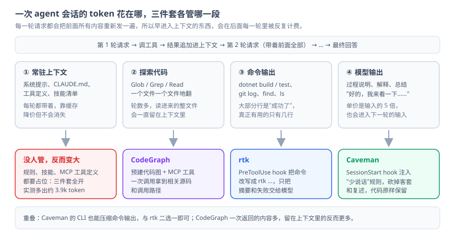
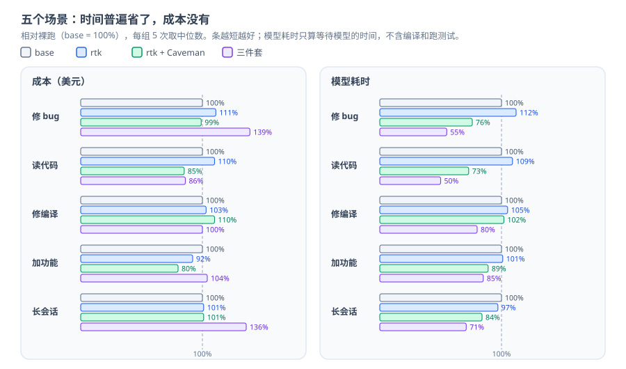
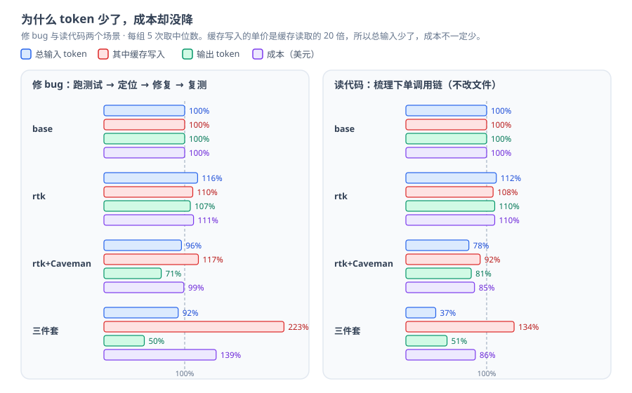

## 前言

打开 Claude Code 的用量面板，很容易产生一个错觉：token 都花在"写代码"上了。真去翻一次会话的记录，会发现写代码的那几次 Edit 只占很小一部分，大头是另外几样东西——agent 为了搞清楚代码结构，一个文件一个文件地 Grep、Read；跑一次 `dotnet test`，几十行"Passed"原样灌进上下文；最后再用三段话复述一遍它刚才做了什么。

最近有三个开源工具分别对准了这几块：

- [rtk](https://github.com/rtk-ai/rtk?wt.mc_id=MVP_324329)：在命令输出进入上下文之前压缩它，砍的是**输入**。
- [Caveman](https://github.com/JuliusBrussee/caveman?wt.mc_id=MVP_324329)：让模型说话简短，砍的是**输出**。
- [CodeGraph](https://github.com/colbymchenry/codegraph?wt.mc_id=MVP_324329)：预先把代码建成图，用一次查询代替一串 Grep/Read，砍的是**探索**。

三者的 README 都给出了漂亮的数字，但那是各自在各自的场景里测的。把三件套逐个装到一个真实的 .NET 仓库（[dotnet/eShop](https://github.com/dotnet/eShop?wt.mc_id=MVP_324329)）上，在修 bug、读代码、修编译、加功能、长会话五个场景里各跑 5 次对照实验，一共 100 次，结论和 README 里的数字差别不小：

- 三件套全开，**等待模型的时间缩短了 15% 到 50%**，但**成本没有降**，有两个场景还贵了三成多。
- 省时间的主力是 CodeGraph 和 Caveman；**rtk 在五个场景里都没有省**。
- 成本没降的原因，藏在 token 的"种类"里：一次拿回大块代码，正好落在输入里最贵的那一档计费上。

## 一、token 都花在哪

### 先说清几个词

- **token**：模型计费和计量的单位，大致相当于一个英文单词的一部分，或者一两个汉字。账单按"输入多少 token、输出多少 token"算钱。
- **agent**：能自己调用工具干活的 AI，比如 Claude Code、GitHub Copilot 的 agent 模式。你给它一个任务，它会自己去读文件、跑命令、改代码。
- **工具**：agent 能调用的动作。Claude Code 内置的有 Read（读文件）、Grep（搜索文件内容）、Glob（按文件名找文件）、Edit（改文件）、Bash（执行命令行）。"工具调用"就是 agent 用了一次其中之一。
- **子代理**：主 agent 为了处理某个子任务而派出去的另一个 agent，它有自己独立的上下文。
- **轮 / 请求**：agent 每做一步（读一个文件、跑一条命令）都要把当前的全部内容发给模型一次，模型决定下一步做什么。一个任务通常要来回十几轮。
- **上下文**：每一轮发给模型的全部内容——系统说明、你的问题、到目前为止读过的文件和命令输出、模型自己说过的话。
- **提示缓存**：既然每一轮的开头部分都和上一轮一样，模型服务商会把这部分缓存起来。第一次放进缓存叫**缓存写入**，比正常输入贵（Claude Code 用的 1 小时缓存是 2 倍价）；之后再命中叫**缓存读取**，只要正常输入价的十分之一甚至更低。
- **hook**：Claude Code 在特定时刻（会话开始、执行命令前、用户提问时）自动运行的脚本，可以往上下文里加内容，或者改写即将执行的命令。
- **MCP**：给 agent 接入外部工具的标准协议，装一个 MCP 服务器，agent 就多了一个可以调用的工具。详见[什么是 MCP](/2025/06/13/what-is-mcp/)。

### 四块开销

一次 agent 会话的 token 可以拆成四块：



1. **常驻上下文**：每次会话固定带上的内容——Claude Code 自己的系统提示、项目里的说明文件 CLAUDE.md（会被自动读入）、各个工具的使用说明、已安装技能的清单。每一轮请求都要带上，好在有提示缓存，重复部分按缓存读取价计费，比正常输入便宜一个数量级。
2. **探索**：agent 为了理解代码而做的 Glob、Grep、Read。轮数多，而且读进来的整个文件会一直留在上下文里。
3. **命令输出**：build、test、git、find 的结果。大部分行是"成功了"，真正有用的只有几行。
4. **模型输出**：模型自己写的过程说明、解释和总结。以实测用的 Claude Sonnet 为例，Claude Code 按输入每百万 token 3 美元、输出 15 美元计费，**输出单价是输入的 5 倍**；而且这些输出会成为下一轮的输入。

agent 循环有一个容易被忽略的特点：每一轮请求都把前面所有内容重新发一遍。第 3 轮读进来的一个 500 行文件，在第 4 到第 20 轮里会再被发送 17 次——虽然缓存让后面的发送变便宜了，但上下文越长，每一轮的基础开销就越高。所以省 token 的关键不是某一步少花一点，而是别让大块内容进入上下文——进来一次，后面每一轮都要为它再付一次钱。

三件套正好各管一段：rtk 管 ③，CodeGraph 管 ②，Caveman 管 ④。①没人管，而且装得越多它越大：三件套全开时，实测多出约 3.9K token。

## 二、rtk：压缩命令输出

### 工作原理

rtk 是一个 Rust 写的单文件 CLI，本身是一组针对常用命令的"过滤器"：`rtk git status`、`rtk dotnet build`、`rtk grep` 等，执行原命令，然后只把摘要和失败信息打印出来。

它接入 agent 的方式是一个 hook。以 Claude Code 为例，`rtk init -g` 会往 `~/.claude/settings.json` 里加一个 `PreToolUse` hook：

```json
{
  "hooks": {
    "PreToolUse": [
      {
        "matcher": "Bash",
        "hooks": [
          { "type": "command", "command": "rtk hook claude" }
        ]
      }
    ]
  }
}
```

agent 每次要执行 Bash 命令之前，hook 先拿到命令，如果 rtk 有对应的过滤器，就把它改写成 `rtk <原命令>`。agent 自己完全不需要知道 rtk 的存在。同时它还会写一个 `RTK.md`，并在 `CLAUDE.md` 里用 `@RTK.md` 引用，告诉模型"输出是压缩过的，不完整时用 `rtk bypass` 重跑"：

```markdown
# Command output

Command output here is condensed to save tokens, keeping every signal and
dropping costly noise. Treat it as the complete result: run commands
normally, and batch related commands into one call to avoid extra turns.
Truncated results state their recovery path in their own output. Re-run a
command as `rtk bypass <cmd>` only when its result is unusable: empty when
output was clearly expected, contradicting its exit code, or garbled.
```

README 里给出的三个承诺值得记住：过滤器出错时原样返回原始输出，退出码照常传递；输出永远不会比原命令更长；任何命令都能用 `rtk bypass` 绕过过滤。

### 安装

Windows 上用 winget：

```powershell
winget install rtk-ai.rtk
rtk init -g          # 写入 ~/.claude 下的 hook、RTK.md 和 CLAUDE.md 引用
rtk init --show      # 检查各项是否就位
```

macOS 用 `brew install rtk`，Linux / WSL 用官方的 `install.sh`。注意 crates.io 上有另一个同名的 `rtk` 包，装完以后 `rtk gain` 能显示节省统计才说明装对了。

`rtk init` 支持 `--dry-run` 预览会改哪些文件，改的是 `CLAUDE_CONFIG_DIR` 指向的目录（默认 `~/.claude`），想先在沙箱里试的话可以把这个环境变量指到一个临时目录。除了 Claude Code，`--copilot`、`--codex`、`--gemini`、`--agent cursor` 等参数可以接入其他工具。

### 实际效果

在 eShop 的 `Ordering.UnitTests` 上，先看 `dotnet build`。原始输出 16 行：

```text
  Determining projects to restore...
  All projects are up-to-date for restore.
  EventBus -> C:\Users\...\eShop\artifacts\bin\EventBus\debug\EventBus.dll
  eShop.ServiceDefaults -> C:\Users\...\eShop\artifacts\bin\eShop.ServiceDefaults\debug\eShop.ServiceDefaults.dll
  EventBusRabbitMQ -> C:\Users\...\eShop\artifacts\bin\EventBusRabbitMQ\debug\EventBusRabbitMQ.dll
  IntegrationEventLogEF -> C:\Users\...\eShop\artifacts\bin\IntegrationEventLogEF\debug\IntegrationEventLogEF.dll
  Ordering.Domain -> C:\Users\...\eShop\artifacts\bin\Ordering.Domain\debug\Ordering.Domain.dll
  Ordering.Infrastructure -> C:\Users\...\eShop\artifacts\bin\Ordering.Infrastructure\debug\Ordering.Infrastructure.dll
  Ordering.API -> C:\Users\...\eShop\artifacts\bin\Ordering.API\debug\Ordering.API.dll
  Ordering.UnitTests -> C:\Users\...\eShop\tests\Ordering.UnitTests\bin\Debug\net11.0\Ordering.UnitTests.dll

Build succeeded.
    0 Warning(s)
    0 Error(s)

Time Elapsed 00:00:03.18
```

`rtk dotnet build` 只剩一行：

```text
ok dotnet build: 8 projects, 0 errors, 0 warnings (00:00:02.63)
```

再看一个有失败用例的 `dotnet test`（故意把 `OrderItem.AddUnits` 里的 `Units += units` 改成了 `Units = units`）。原始输出 26 行，`rtk dotnet test` 剩 16 行：

```text
Failed Tests:
  when_add_two_times_on_the_same_item_then_the_total_of_order_should_be_the_sum_of_the_two_items
    Assertion failed. Expected values to be equal.

expected: 20.0
actual:   10.0

Assert.AreEqual(20.0m, order.GetTotal())
    at eShop.Ordering.UnitTests.Domain.OrderAggregateTest.when_add_two_times_on_the_same_item_then_the_total_of_order_should_be_the_sum_of_the_two_items() in C:\Users\...\eShop\tests\Ordering.UnitTests\Domain\OrderAggregateTest.cs:line 105
   at System.Reflection.MethodBaseInvoker.InterpretedI...


Errors:
  error Build error #1 (details omitted)

fail dotnet test: 41 passed, 1 failed, 0 skipped, 0 warnings in 1 projects (815 ms)
```

失败的测试名、期望值和实际值、出错的行号都保留了，重复的"Expected/Actual"和反射调用栈被砍掉。有一处小瑕疵：测试失败导致的非零退出码被它报成了 `Build error #1`，不影响判断，但看到时别被误导。

几个本机实测的对比（字节数，`wc -c`）：

| 命令 | 原始输出 | rtk 输出 | 减少 |
|---|---:|---:|---:|
| `dotnet build tests/Ordering.UnitTests`（成功） | 1,202 | 64 | 95% |
| `dotnet build eShop.Web.slnf`（失败，1 个编译错误） | 2,064 | 2,066 | 0% |
| `dotnet test`（1 个失败） | 1,445 | 696 | 52% |
| `git log -5` | 1,337 | 355 | 73% |
| `find src -name "*.cs" -path "*Ordering*"` | 8,182 | 2,226 | 73% |
| `grep -rn AddOrderItem src`（5 处命中） | 923 | 923 | 0% |

规律很清楚：**输出越长、重复越多，省得越多**；本来就很短的结果（少量 grep 命中）rtk 原样放过。值得注意的是编译**失败**那一行：在这次实测里，rtk 把原始输出原封不动地交给了模型（只多了两个换行）。`find` 的输出被按目录折叠成一行一组，超出部分给了一个 `rtk recall <hash>` 的恢复入口，模型需要时可以把被省略的内容取回来。

`rtk gain` 可以看累计节省，`rtk discover` 会扫描 Claude Code 的历史，找出"本可以被 rtk 压缩但没有走 rtk"的命令。

### 需要知道的局限

- **只拦截 Bash 工具**。hook 的 matcher 是 `Bash`，Claude Code 内置的 Read、Grep、Glob 不经过它。在 Windows 上还有一个更隐蔽的问题：如果 Claude Code 启用了 PowerShell 工具，agent 用 PowerShell 跑的命令同样不会被改写。
- **不是所有命令都有过滤器**。实测 `rtk hook check` 发现，`dotnet build` 会被改写，但 `dotnet test` 无论怎么写（`dotnet test`、`dotnet test --project …`、`cd … && dotnet test`）都**不会**被 hook 改写，虽然手动执行 `rtk dotnet test` 是可以压缩的。可以先用 `rtk hook check "<命令>"` 确认自己常用的命令在不在名单里。
- **"命令输出砍 90%"不等于"成本砍 90%"**，这句话是 README 自己写的。命令输出只是输入 token 的一部分，在 agent 的实际会话里往往还是很小的一部分。
- **许可证**：`rtk` CLI 是 Apache-2.0，但默认下载里捆绑的 `rtk-engine`（管道引擎）和可选的 `rtk-proxy` 是 BUSL-1.1。公司内部使用免费，只是不能拿它做成商业产品卖给第三方；在意这一点可以装只含 Apache-2.0 部分的 `rtk-oss` 版本。遥测默认关闭（`rtk config` 里 `[telemetry] enabled = false`）。

## 三、Caveman：让模型少说话

### 工作原理

Caveman 的口号是"why use many token when few token do trick"。它现在已经长成了一整套东西（本地代理、工具输出压缩、模型路由、浏览器压缩……），但最核心、也最独立的部分是一组**说话规则**：先给答案，不寒暄、不复述、不用"Sure! I'd be happy to help"，短句、主动语态，但代码、命令、路径、错误信息必须原样保留。

装成 Claude Code 插件之后，它通过 `SessionStart` hook 在会话开始时把这套规则注入上下文，之后整个会话都保持这个风格。手动执行一次这个 hook，能看到注入的内容开头是这样的：

```text
CAVEMAN MODE ACTIVE — mode: caveman

# caveman

Respond terse like smart caveman. All technical substance stay. Only fluff die.

Caveman is a voice, not broken grammar. Reader pays per token and reads in a terminal. Every word earns its place. Every fact survives.
...
### 1. Answer first

Answer, then reason, then next step. Pattern: `[thing] [action] [reason]. [next step].`

Bad: "Sure! I'd be happy to help. The issue you're experiencing is likely caused by..."
Good: "Bug in auth middleware. Token expiry check use `<` not `<=`. Fix:"
```

整段规则约 5 KB，和 README 里说的"规则本身要占约 1,160 个输入 token"对得上。这是一笔固定开销：如果一次会话的回答本来就很短，这 1,160 个 token 可能根本赚不回来。

三档强度：`/caveman`（默认，正常句子去掉废话）、`/ultracave`（更狠，接近电报体）、`/megacave`（文言文风格）。`/caveman off` 或者说一句"normal mode"就能关掉。

### 安装

只要"少说话"这一块，装 Claude Code 插件就够了：

```bash
claude plugin marketplace add JuliusBrussee/caveman
claude plugin install caveman@caveman
```

另外还有一个 CLI（`npm i -g @caveman-ai/cli`），提供代理层、`caveman shrink`、`caveman stats` 等功能。如果装了 CLI，建议先做两件事：

```powershell
caveman telemetry off      # CLI 默认会上报命令、token 数、随机安装 ID、OS 和 IP
caveman off routing        # 关掉 Auto 路由，登录后它会把提问和 CLAUDE.md 发到 Caveman Cloud
```

### 前后对比

下面的数字来自后文实测里的两组对照：一组只开 rtk，一组在此基础上加 Caveman，每组跑 5 次。同一个修 bug 任务（跑测试、找根因、修复、复测），没有 Caveman 时 agent 最后的总结：

```text
全部 42 个测试通过。

**根因**：最近一次提交 "Simplify AddUnits" 把 `OrderItem.AddUnits` 里的 `Units += units` 改成了 `Units = units`，导致同一商品第二次加入购物车时数量被覆盖而不是累加，于是总价计算错误（期望 20 实际得到 10）。

**修改**：恢复 `src/Ordering.Domain/AggregatesModel/OrderAggregate/OrderItem.cs` 中 `AddUnits` 方法的 `Units += units`,未改动任何测试代码。
```

打开 Caveman 之后：

```text
全测试通过（42/42）。

根因：上个提交把 `OrderItem.AddUnits` 的 `Units += units` 改成 `Units = units`。同一商品加两次时，第二次直接覆盖数量，而非累加，导致总价算错。

修改：`src/Ordering.Domain/AggregatesModel/OrderAggregate/OrderItem.cs` 恢复 `Units += units`。
```

信息一条没少，"导致……于是……"这类连接词和"未改动任何测试代码"这种自我说明被砍掉了（最终总结的长度中位数从 278 字符降到 205 字符）。两组唯一的差别就是 Caveman，整次会话的输出 token 中位数从 1,633 降到 1,079（-34%）。省下的不只是最后这段总结，agent 在每次调用工具前说的那句"我先看一下……"也变短了。

在读代码的任务里（梳理下单流程的调用链），输出 token 从 4,927 降到 3,607（-27%），最终回答的长度中位数从 4,560 字符降到 2,888 字符，而回答里该出现的 8 个关键类名，5 次里分别有 4 次和 3 次全部提到，信息量基本没有损失。中文本身就比英文紧凑，所以压缩幅度不像 README 里英文示例那样夸张（63 → 20 token）。

### 需要知道的局限

- **按请求计费时没用**。GitHub Copilot 这类按"请求次数"计费的工具，回答短一点不会少收钱。
- **和 rtk 有重叠**。Caveman 的 CLI 里也有压缩工具输出的功能（它叫 read-less，以及 `caveman shrink` 命令），和 rtk 管的是同一段。两个都开只会互相抢活，选一个就好。只装 Caveman 插件、输入侧交给 rtk，两者就不会打架。
- **别把自己的提示词也"原始人化"**。README 引用的研究表明，把用户提示词压成电报体会让答案变差，所以 Caveman 从不改写用户的输入，只约束模型的输出。

## 四、CodeGraph：用代码图代替翻文件

### 工作原理

agent 理解代码的默认方式是"人肉 grep"：Grep 找到符号，Read 打开文件，看到一个调用再 Grep 下一个……CodeGraph 先用 tree-sitter（一个支持几十种语言的通用代码解析库）把整个仓库解析一遍，抽出函数、类、方法这些"点"，以及谁调用谁、谁继承谁、谁实现谁这些"线"，存进项目目录下的一个 SQLite 数据库（`.codegraph/`），再通过一个 MCP 工具 `codegraph_explore` 提供给 agent。agent 问一次，就能拿到相关代码的源码和它们之间的调用路径，不用自己一层层去找。文件改动后它会自动更新索引，默认在最后一次改动 2 秒后执行。

### 安装

```powershell
irm https://raw.githubusercontent.com/colbymchenry/codegraph/main/install.ps1 | iex
# 或者：npm i -g @colbymchenry/codegraph

cd your-repo
codegraph install --target=claude --location=local --yes   # 只接入 agent，不建索引
codegraph init                                              # 建索引
```

`install` 和 `init` 是两步：前者只负责把 MCP 配置写进 agent，后者才真正建索引。eShop（642 个文件，C# 为主，带 Razor 和少量 JS/TS）的索引用了 12.3 秒：

```text
◆  Indexed 642 files
│
●  5,238 nodes, 8,073 edges in 12.3s
```

`--location=local` 会在项目里写下这几样东西，可以一起提交给团队：

`.mcp.json`：

```json
{
  "mcpServers": {
    "codegraph": {
      "type": "stdio",
      "command": "codegraph",
      "args": ["serve", "--mcp"],
      "alwaysLoad": true
    }
  }
}
```

`alwaysLoad: true` 很关键：Claude Code 默认会把 MCP 工具藏在一个"工具搜索"步骤后面按需加载，这个字段让 `codegraph_explore` 从第一轮就可用，否则 agent 很可能根本想不起来用它。

`.claude/settings.json` 里除了放行 `mcp__codegraph__*`，1.6 版还加了一个 `UserPromptSubmit` hook：每次用户提问时，`codegraph prompt-hook` 会先按问题查一次图，把相关的结构信息作为 `<codegraph_context>` 塞进上下文。`.claude/CLAUDE.md` 里则加了一段说明，让模型在 grep 之前先找 CodeGraph，并且在没有 MCP 的子代理里改用 `codegraph explore` 命令行。

### 命令行也能用

CodeGraph 的 CLI 本身就是一个好用的代码导航工具。查谁调用了 `AddUnits`：

```text
$ codegraph callers AddUnits
Callers of "AddUnits" (2):

method eShop.Ordering.Domain.AggregatesModel.OrderAggregate::OrderItem::AddUnits (csharp) — src/Ordering.Domain/AggregatesModel/OrderAggregate/OrderItem.cs:54
method      Invalid_units_setting
  tests/Ordering.UnitTests/Domain/OrderAggregateTest.cs:93

method      AddOrderItem
  src/Ordering.Domain/AggregatesModel/OrderAggregate/Order.cs:81
```

改 `AddUnits` 会影响到哪些地方：

```text
$ codegraph impact AddUnits --depth 2
Impact of changing "AddUnits" — 6 affected symbols:
...
src/Ordering.Domain/AggregatesModel/OrderAggregate/Order.cs
  method      AddOrderItem:69

src/Ordering.API/Application/Commands/CreateOrderCommandHandler.cs
  method      Handle:29

src/Ordering.API/Application/Commands/CreateOrderDraftCommandHandler.cs
  method      Handle:10

tests/Ordering.UnitTests/Builders.cs
  method      AddOne:26
```

这两个结果分别只有 375 和 744 字节。用 grep 得到同样的信息，需要先搜方法名，再逐个打开文件确认是不是真的调用（而不是注释里提到的同名字符串），然后再往上追一层。

`codegraph affected --stdin` 还能配合 `git diff --name-only` 算出受改动影响的测试文件，用在 CI 里只跑相关测试。

### 需要知道的局限

- **`explore` 一次返回的东西不少**。`codegraph explore "AddUnits AddOrderItem"` 输出了 650 行、约 25 KB，按 4 字节一个 token 粗算是 6k token。它省掉的是"来回翻文件的轮数"，代价是单次结果偏大。README 自己也承认：会话结束时，CodeGraph 留在上下文里的检索内容比读文件的 agent 更多，七个测试仓库**平均多 82%**；差距最大的是 VS Code 仓库，67k 对 18k token。
- **子代理不受益**。子代理看不到主会话里关于 CodeGraph 的指引，照样会去读文件，此时 CodeGraph 只是额外开销。
- **索引有短暂延迟**。刚改过的文件在索引更新前（约 2 秒）可能还是旧内容，返回结果里会带 `⚠` 提示。
- 大于 1 MB 的文件会被跳过；`node_modules`、`bin`、`obj` 以及 `.gitignore` 里的内容默认不索引，可以用项目根目录的 `codegraph.json` 调整 `exclude`/`include`。

## 五、三件套装在一起

按"先装、先验证、再叠下一个"的顺序来，每一步都能单独确认效果：

```powershell
# 1. rtk：输入侧，全局生效
winget install rtk-ai.rtk
rtk init -g
rtk hook check "git status"          # 应输出：rtk git status

# 2. Caveman：输出侧，只装插件
claude plugin marketplace add JuliusBrussee/caveman
claude plugin install caveman@caveman

# 3. CodeGraph：探索侧，按项目开启
irm https://raw.githubusercontent.com/colbymchenry/codegraph/main/install.ps1 | iex
cd your-repo
codegraph install --target=claude --location=local --yes
codegraph init
```

为什么这样分：rtk 和 Caveman 的收益与项目无关，放在用户级；CodeGraph 需要索引，而且在目标明确的小任务里，它的固定开销和大块返回结果可能比省下的还多，按项目决定要不要开更合适。`--location=local` 生成的 `.mcp.json`、`.claude/settings.json`、`.claude/CLAUDE.md` 可以直接提交，团队成员 clone 下来装好 `codegraph` 命令就能用；`.codegraph/` 索引目录应该加进 `.gitignore`。

装完以后，三者在 Claude Code 里各自挂在不同的位置，互不干扰：

| 工具 | 挂载点 | 作用时机 |
|---|---|---|
| Caveman | `SessionStart` hook | 会话开始时注入一次说话规则 |
| CodeGraph | MCP 工具 + `UserPromptSubmit` hook | 每次提问时预查一次图；agent 需要时主动调用 |
| rtk | `PreToolUse` hook（matcher: `Bash`） | 每条 Bash 命令执行前改写 |

几个需要留意的冲突点：

- **Windows 上留意 agent 用的是哪个 shell**。rtk 只挂在 Bash 工具上。如果 Claude Code 开着 PowerShell 工具，agent 跑命令时可能走 PowerShell，rtk 就完全不起作用。想让它只用 Bash，可以启动时加 `--disallowedTools PowerShell`，或者在 `settings.json` 的 `permissions.deny` 里加上 `"PowerShell"`。
- **Caveman 的 CLI 层和 rtk 二选一**。只装 Caveman 插件就不会和 rtk 冲突；如果还用 `caveman claude` 启动并打开了它的输入压缩功能，两者会压缩同一段输出。
- **新开的工作区要先"信任"**。CodeGraph 写在项目 `.claude/settings.json` 里的权限和 hook，在 Claude Code 没有信任过的目录里会被忽略（启动时有一行 `Ignoring ... this workspace has not been trusted` 提示）。交互式打开一次项目、接受信任对话框即可。

试过觉得不划算，卸载也是三条命令：

```powershell
rtk init -g --uninstall                  # 移除 hook、RTK.md 和 CLAUDE.md 里的引用
claude plugin uninstall caveman@caveman
codegraph uninit                         # 在项目目录里执行，移除该项目的 CodeGraph
codegraph uninstall                      # 从各个 agent 的配置里移除 CodeGraph
```

## 六、实测

### 方法

- **仓库**：dotnet/eShop（提交 `3c6e531`），一个由二十多个项目组成的 .NET 11 微服务示例。
- **环境**：.NET SDK 11.0.100，Claude Code 2.1.237，`--model sonnet`（实际解析为 `claude-sonnet-5`），推理强度（effort）为 medium。rtk 1.2.1，Caveman 4.2.0（只用插件），CodeGraph 1.6.4。
- **五个场景**，每个都有自动化的对错判定：

| 场景 | 起点 | 任务 | 怎么判对错 |
|---|---|---|---|
| 修 bug | 一个"看起来很合理"的提交把 `OrderItem.AddUnits` 的 `Units += units` 改成了 `Units = units`，一个单元测试失败 | 跑测试、找根因、修产品代码（不许改测试）、复测 | 结束后脚本再跑一次测试 |
| 读代码 | 同上 | 从 Ordering.API 的 HTTP 端点开始，梳理创建订单一路到写库、发出领域事件和集成事件的调用链，不改文件 | 回答里是否出现 8 个关键节点 |
| 修编译 | 一个提交只在接口里把 `IEventBus.PublishAsync` 改名为 `PublishEventAsync`，6 个项目里的 7 个文件没跟上，`dotnet build eShop.Web.slnf` 失败 | 完成改名，让整个解决方案重新编译通过 | 结束后脚本再编译一次，且接口没被改回去 |
| 加功能 | 干净的上游代码 | 给订单加一个可选的买家备注 `Comment`：API 能传入、存进数据库、查询时返回，并补单元测试 | API 项目能编译、测试通过、领域模型/命令/查询里都有 `Comment` |
| 长会话 | 同修 bug | 同一个会话里连发三条指令：先修 bug；再问"订单状态从 Submitted 变成 AwaitingValidation 是谁触发的"；最后给 `Order.SetAwaitingValidationStatus` 补单元测试 | 测试通过、新增了测试、第二问答到了 `GracePeriod` 那条链 |

"修编译"是专门给 rtk 准备的主场：编译输出长，agent 往往要编译好几次。"加功能"和"长会话"用来看 CodeGraph 在改代码、在上下文越积越多时的表现。

- **四组配置**：裸跑（base）、只开 rtk、rtk + Caveman、三件套全开。四组是**逐个叠加**的，所以要看某一个工具自己的效果，应该拿它和**左边相邻的那一列**比：rtk 看第 2 列对第 1 列（base），Caveman 看第 3 列对第 2 列，CodeGraph 看第 4 列对第 3 列。
- 每个"场景 × 配置"跑 5 次，一共 100 次，下表每一格都是 5 次的中位数。最早的 24 次（修 bug、读代码的前 3 轮）四组交替顺序执行，其余 76 次四组各用一份独立的 eShop 副本并行执行。全部运行都用 `claude -p --output-format stream-json` 记录每次的 token 用量、Claude Code 自己报告的成本（按 API 价格估算，包含缓存读写）和耗时。订阅用户不会按这个成本付钱，但可以把它当作额度消耗快慢的参照。
- **时间只看"模型耗时"**，也就是等待模型回复的时间（Claude Code 记录为 `duration_api_ms`）。总耗时里还包括编译、跑测试，而且四组并行时会互相抢 CPU，没法比。
- 为了让四组之间唯一的差别就是这三个工具，所有运行都加了 `--setting-sources project`（不加载个人全局配置）、`--strict-mcp-config`，工具集固定为 `Bash,Read,Edit,Write,Glob,Grep`（关掉了 PowerShell 工具和子代理）。
- **正确性**：100 次运行，修 bug、修编译、加功能、长会话四个场景的自动判定**全部通过**。读代码场景没有对错之分，只统计关键节点的命中数。

### 结果

先看最关心的两个数：成本和时间。

**成本（美元）**：

| 场景 | base | rtk | rtk + Caveman | 三件套 |
|---|---:|---:|---:|---:|
| 修 bug | 0.124 | 0.138 | 0.123 | 0.172 |
| 读代码 | 0.293 | 0.322 | 0.249 | 0.253 |
| 修编译 | 0.261 | 0.268 | 0.288 | 0.260 |
| 加功能 | 0.659 | 0.604 | 0.528 | 0.686 |
| 长会话 | 0.512 | 0.515 | 0.517 | 0.695 |

**模型耗时（秒）**：

| 场景 | base | rtk | rtk + Caveman | 三件套 |
|---|---:|---:|---:|---:|
| 修 bug | 18.4 | 20.6 | 14.0 | 10.1 |
| 读代码 | 45.4 | 49.6 | 33.2 | 22.8 |
| 修编译 | 43.3 | 45.6 | 44.0 | 34.6 |
| 加功能 | 88.6 | 89.1 | 79.1 | 75.6 |
| 长会话 | 76.2 | 74.1 | 63.7 | 54.1 |

**轮数**：

| 场景 | base | rtk | rtk + Caveman | 三件套 |
|---|---:|---:|---:|---:|
| 修 bug | 8 | 9 | 7 | 5 |
| 读代码 | 16 | 17 | 13 | 3 |
| 修编译 | 16 | 17 | 17 | 14 |
| 加功能 | 37 | 32 | 28 | 24 |
| 长会话 | 26 | 26 | 24 | 17 |

换成相对裸跑的比例：



一眼能看出的规律：**右边的时间普遍变短了，左边的成本没有**。三件套全开时，模型耗时在五个场景里都降了（-15% 到 -50%），成本却是两个持平、一个略降、两个涨了三成多。

同一组 5 次运行之间的差异不小：裸跑读代码的轮数在 13 到 24 之间，三件套加功能的成本在 0.63 到 0.95 美元之间。所以 10% 以内的差别都应该当成噪声，只看方向一致、幅度够大的变化。

### 怎么理解这些数字

**rtk：五个场景都没有省，连"修编译"这个主场也没有。** 和裸跑比，成本在 -8% 到 +11% 之间，模型耗时在 -3% 到 +12% 之间，全在噪声范围里。原因有四个：

- **编译输出本来就不大，失败时 rtk 也没压缩。** 编译成功时，`rtk dotnet build` 把整个解决方案几十行的输出压成一行（实测 -97% 到 -99%）；而在这次实测里，失败的编译输出被原样放行（2,064 → 2,066 字节），而这恰恰是 agent 最需要读输出的时候。更关键的是量级：一次失败编译的输出只有 2 KB 左右（约 500 token），成功那次能省下的也就 1K token 上下，而一次修编译会话的总输入有 35 万 token 左右。
- agent 自己就会截断输出：跑测试带 `| tail -100`，看文件用 `sed -n '80,115p'`，编译带 `| tail -n 40`。
- `dotnet test` 不在 hook 的改写名单里。
- 读代码时，agent 要么用内置的 Read（rtk 看不到），要么用 `cat`、`sed -n` 读源码（源码里没有可删的噪声）。

`rtk gain` 的统计也印证了这一点：整个实验期间（含手动测试）它一共处理了 303 条命令，省下 30.6K token，而 100 次运行的总输入有 4,884 万 token。

**Caveman：省时间比省钱明显。** 对比只开 rtk 的那一组：

| 场景 | 输出 token | 成本 | 模型耗时 |
|---|---:|---:|---:|
| 修 bug | -34% | -11% | -32% |
| 读代码 | -27% | -23% | -33% |
| 修编译 | -5% | +7% | -4% |
| 加功能 | -14% | -13% | -11% |
| 长会话 | -7% | 0% | -14% |

输出少了，但输出在成本里只占两成左右，所以成本变化不大，修编译那组甚至在噪声里略涨。时间上，五个场景里有四个明显缩短（-11% 到 -34%），修编译基本没变：模型生成输出比读取输入慢得多，少写一句话就少等一会儿；修编译和长会话里输出本来就以代码和命令为主，可砍的废话少，效果也就弱。另外，同一组里轮数也少了几轮（读代码 17 → 13），这部分是 Caveman 规则的作用还是随机波动，5 次运行分不清。

**CodeGraph：轮数和时间都少了，但在三个场景里贵了三成以上。** 对比 rtk + Caveman 那一组：

| 场景 | 轮数 | 模型耗时 | 成本 |
|---|---|---:|---:|
| 修 bug | 7 → 5 | -28% | **+40%** |
| 读代码 | 13 → 3 | -31% | +2% |
| 修编译 | 17 → 14 | -21% | -10% |
| 加功能 | 28 → 24 | -4% | **+30%** |
| 长会话 | 24 → 17 | -15% | **+34%** |

轮数少了，钱却没少，原因要从 token 的"种类"说起。以修 bug 和读代码为例，把总输入拆开看：

| 场景 | 配置 | 总输入 token | 其中缓存写入 | 输出 token |
|---|---|---:|---:|---:|
| 修 bug | base | 152,522 | 9,437 | 1,520 |
| | rtk | 176,418 | 10,370 | 1,633 |
| | rtk + Caveman | 146,165 | 11,077 | 1,079 |
| | 三件套 | 140,787 | 21,000 | 759 |
| 读代码 | base | 286,793 | 24,497 | 4,463 |
| | rtk | 319,897 | 26,472 | 4,927 |
| | rtk + Caveman | 222,529 | 22,443 | 3,607 |
| | 三件套 | 104,937 | 32,898 | 2,284 |

"总输入 token"是所有轮次发给模型的内容之和：比如裸跑修 bug 用了 8 轮，每轮的上下文约 1.9 万 token，加起来就是 15 万。这个数大不代表贵，裸跑这一组里九成以上是按一折计费的缓存读取。"其中缓存写入"是第一次进入上下文、按 2 倍价计费的那部分。



留意红色的"其中缓存写入"：三件套的总输入和输出都明显变少，成本却没跟着降，原因就在这一条。把一次修 bug 运行里每一轮请求的缓存读写拆开看（`r` 是缓存读取的 token 数，`w` 是缓存写入的 token 数，从左到右是第 1 轮、第 2 轮……）：

```text
rtk + Caveman  11278r/7980w  19258r/952w  20210r/381w  20591r/337w  20928r/332w  21260r/438w  21698r/413w
三件套          11915r/9212w  21127r/928w  22055r/8528w  30583r/430w  31013r/398w
```

第一轮两边都有约 1.1 万 token 的缓存读取，那是系统说明等固定内容，前面的运行已经把它们放进了缓存。第一轮三件套多写入了约 1.2K，是 CodeGraph 的工具说明和 CLAUDE.md 里的那段指引（这条提问的自动预查没有返回内容）。真正的差别在第 3 轮：一次写入 8,528 个 token，那就是 `codegraph_explore` 返回的结果（5 次运行里这一笔在 8,500 到 10,700 之间）；另一组每一轮只新增几百个 token。

Claude Code 用的是 1 小时缓存（用量里记为 `ephemeral_1h_input_tokens`），新内容第一次进入上下文时按 2 倍输入价计费（每百万 6 美元），之后每轮再发送只按十分之一计费。光是这一笔 8,528 token 的写入就要约 0.05 美元，差不多就是修 bug 场景里三件套多花的那 0.049 美元。

换句话说，**CodeGraph 用"一次拿很多"换掉了"多次拿一点"**：轮数和总 token 都少了，输入里最贵的那部分（缓存写入，普通输入的 2 倍、缓存读取的 20 倍）却多了。另外三个场景各有各的原因：

- **加功能**：agent 在改文件前仍然习惯把要改的文件完整读一遍（Read 次数的中位数只从 9 降到 6），CodeGraph 的结果没能替代这些读取，却又多出两次各约 6K token 的图查询结果。时间只省了 4%，成本涨了 30%。
- **长会话**：三条指令里有两条用了 CodeGraph，大块结果一直留在上下文里，后面每一轮都要带着；而且每条新指令提交时，自动预查又会往上下文里加一批内容。缓存写入从 3.9 万涨到 6.8 万，成本涨了 34%。这和它 README 里"会话结束时留在上下文里的检索内容更多"的提醒一致。
- **修编译**：5 次运行里 agent 一次都没有主动调用 `codegraph_explore`——找出所有 `PublishAsync` 的调用处，grep 就是最直接的办法。但提问时的自动预查往第一轮上下文里塞了约 4K token 的相关代码位置，有 3 次 agent 因此跳过了开头那次必然失败的编译，直接动手改。时间少了 21%，成本和裸跑持平。

完整度方面，读代码场景里三件套的 5 次回答**每次都漏了至少一个关键节点**：`TransactionBehavior` 漏了 2 次（其他三组 15 次里一次没漏），`OrderStatusChangedToSubmittedIntegrationEvent` 漏了 3 次（其他三组合计漏了 4 次）。agent 拿到图查询结果后就直接作答，不再逐个打开文件核对——CodeGraph 给模型的工具说明里本来就写着"相信 codegraph 的结果，不要再用 grep 复查"。以 `TransactionBehavior`（开启数据库事务、提交后发布集成事件都在这一层）为例，它是 MediatR 的管道行为，靠依赖注入注册后自动包在每个命令外面，代码里没有地方直接调用它，调用图里就可能没有这条线。其他四个场景有自动判定的，三件套全部通过。

**固定开销不容忽视。** 只让 agent 回复一个 "ok"，四组配置第一轮的上下文就分别有 17,136、17,288、19,177、21,040 token。Caveman 的规则和技能清单、CodeGraph 的 MCP 工具说明和 CLAUDE.md 片段，在每一轮里都占着位置。这还是最低值：提问里出现具体的类名、方法名时，CodeGraph 的自动预查会再塞进 4K 以上的 token（读代码、修编译、加功能三个场景，三件套第一轮都是约 2.5 万 token，裸跑是 1.7 万）。

## 七、什么时候装，什么时候别装

把实测和三个项目 README 里自己承认的局限放在一起，结论是这三个工具都不是"装了就省"，而且省的主要是时间：

**rtk** 在 Claude Code + .NET 这种组合下几乎没有作用：编译输出本来就不大，`dotnet test` 不在名单里，读代码又走内置 Read。它更适合输出又长又吵、而且成功时输出也很长的命令（`npm install`、`cargo test`、`pytest`、`docker build`、`kubectl`），或者 Codex CLI 这种几乎所有事情都通过 shell 完成的 agent。装之前先跑 `rtk discover`，它会扫描 Claude Code 的历史记录，告诉你有多少命令本可以被压缩。

**Caveman** 是三个里最"无害"的：五个场景里有四个明显缩短了等待时间，成本基本不涨，常驻开销实测约 1.9K token（规则约 1,160，加上插件的技能清单）。如果你嫌 agent 啰嗦、想少等一会儿，可以装。不过在按请求计费的工具（GitHub Copilot）里它不省钱；需要给新人写详细解释的时候也该关掉。

**CodeGraph** 适合"读"：大仓库、陌生代码、需要跨很多文件追踪调用关系的问题，速度提升最明显（读代码场景轮数从 13 降到 3，时间少了三成）。但在"改"和"长会话"里它会让成本明显上升：改代码时 agent 照样会去读要改的文件，大块的图查询结果又会一直留在上下文里。如果你按量付费，建议只在需要梳理代码结构时打开它；它给出的架构梳理也要对照代码核实，图里看不到依赖注入、管道这类"隐式"的调用。

## 总结

- 三个工具各管一段：rtk 压命令输出，Caveman 压模型输出，CodeGraph 用代码图替代逐个翻文件。它们挂在不同的 hook 上，只装 Caveman 插件（不用它的 CLI 压缩）时可以同时装、互不冲突。
- 在 eShop 五个场景、100 次运行的实测里，**三件套全开让模型耗时缩短了 15% 到 50%，成本却是两个场景持平、一个略降、两个涨了三成多**。
- **rtk 在五个场景里都没有省**，包括专门给它准备的"修编译"：编译输出本来就只占会话的一小部分，而且这次实测里失败的编译被原样放行。
- **Caveman 在五个场景里有四个明显缩短了等待时间**（-11% 到 -34%），输出少了 5% 到 34%，但输出只占成本两成左右，成本变化不大。
- **CodeGraph 和 Caveman 各贡献了一半左右的提速，而成本上涨几乎全部来自 CodeGraph**：它一次拿回大块代码，落在输入里最贵的缓存写入那一档；在改代码和长会话里尤其明显。
- 别只看"token 少了多少"。一次会话的成本由缓存读取、缓存写入、普通输入和输出四种单价不同的 token 组成，减少总量不等于减少成本。最可靠的办法还是在自己的仓库、自己的任务上跑一遍对照：`claude -p --output-format json` 会直接给出每次运行的用量、成本和模型耗时。
